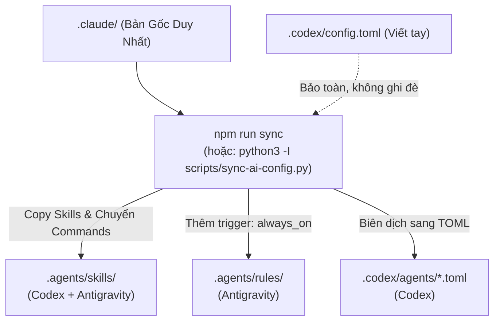

# CivicLaw AI 🏛️⚖️

> **Trợ lý AI Hỗ trợ Pháp lý & Dịch vụ Công cho Công dân**  
> Xây dựng theo tôn chỉ **Minh bạch, Chính xác và Có thể Kiểm chứng**.

---

## 🌟 Tính Năng Nổi Bật của Dự Án

* **Kiến trúc Cấu hình Đa AI (1 Bản Gốc - 2 Bản Sinh):** Một lần viết cấu hình trong `.claude/`, script tự động chuyển đổi định dạng và phân phối cho cả **Claude Code**, **OpenAI Codex** và **Google Antigravity**.
* **Quy chuẩn Spec-Driven Development (SDD):** *"5 phút viết spec thay vì 5 ngày ngồi sửa"*. Mọi nghiệp vụ đều tuân thủ luồng đóng gói:
  $$\text{spec} \longrightarrow \text{plan} \longrightarrow \text{tasks} \longrightarrow \text{tests} \longrightarrow \text{code}$$
* **Triết lý Lập trình Tối giản (Ponytail):** Áp dụng chiếc thang 7 bậc YAGNI, triệt tiêu over-engineering, không sinh code thừa và bảo vệ ranh giới an toàn hệ thống.
* **Kiểm thử TDD Tự động:** Tích hợp `Vitest` quét tự động các bộ test nghiệp vụ theo chuẩn BDD (*Given - When - Then*).

---

## 🗺️ Lộ Trình Phát Triển 2 Giai Đoạn (Two-Phase Evolution)

Dự án được phân kỳ rạch ròi theo 2 giai đoạn phát triển:

| Giai đoạn | Mục tiêu & Bản chất | Các Module SDD tương ứng | Trạng thái |
| :--- | :--- | :--- | :---: |
| **Giai đoạn 1: Core Foundation**<br>*(Grounded Legal Assistant)* | Xây dựng kho dữ liệu 5 bộ luật chính thống, tìm kiếm kết hợp Hybrid (`pgvector` + `tsvector`) và luồng hỏi đáp có căn cứ trích dẫn nguồn 100%, hỗ trợ streaming. | • `specs/002-legal-data-ingestion/`<br>• `specs/003-hybrid-legal-search/`<br>• `specs/004-legal-qa-citations/`<br>• `specs/005-chat-session-memory/` | 🚧 **Đang thực hiện** |
| **Giai đoạn 2: Agentic Evolution**<br>*(Autonomous AI Agent & Contract Auditor)* | Nâng cấp thành AI Agent tự chủ với hộp công cụ (Tool Calling / Function Calling), vòng lặp suy luận ReAct và hệ thống rà soát rủi ro hợp đồng cá nhân PDF/DOCX (3 mức cảnh báo). | • `specs/006-contract-auditor/`<br>• Agent Tool Calling & ReAct Loop<br>• Tự động đặt câu hỏi làm rõ (Clarification) | ⏳ **Kế hoạch tiếp theo** |

---

## 📂 Cấu Trúc Thư Mục Chuẩn

```
civiclaw-ai/
├── CLAUDE.md                            # Tóm tắt dự án cho Claude Code
├── AGENTS.md                            # Tóm tắt dự án cho Codex + Antigravity
├── GEMINI.md                            # Đồng bộ quy chuẩn cho Gemini CLI
├── README.md                            # Hướng dẫn tổng quan dự án
├── package.json                         # Dependencies & Scripts điều khiển
├── vitest.config.ts                     # Cấu hình kiểm thử tự động
│
├── docs/                                # 📖 TÀI LIỆU ĐẶC TẢ SẢN PHẨM (BA PERSPECTIVE)
│   ├── PRD.md                           # Tổng quan bài toán, mục tiêu, 2 giai đoạn phát triển
│   └── references/                      # Văn bản đặc tả gốc lưu trữ
│
├── .claude/                             # 🌟 BẢN GỐC (MASTER SOURCE OF TRUTH)
│   ├── rules/                           # Quy tắc dự án (SDD, Ponytail, Gotchas)
│   ├── skills/                          # Kỹ năng mở rộng của Agent
│   ├── commands/                        # Lệnh slash command
│   ├── agents/                          # Định nghĩa Subagent chuyên biệt
│   └── settings.json                    # Cấu hình Claude Code
│
├── .agents/                             # 🤖 TỰ SINH (Cho Codex + Antigravity)
│   ├── rules/                           # Rules có trigger: always_on cho Antigravity
│   └── skills/                          # Skills dùng chung cho cả 2 AI
│
├── .codex/                              # 🤖 TỰ SINH & CẤU HÌNH CHO CODEX
│   ├── config.toml                      # Cấu hình Codex (viết tay, không bị ghi đè)
│   └── agents/                          # Subagents định dạng TOML cho Codex
│
├── scripts/                             # ⚙️ BỘ TOOL ĐỒNG BỘ CẤU HÌNH
│   ├── sync-ai-config.py                # Script đồng bộ bằng Python chuẩn
│   └── sync-ai-config.mjs               # Script đồng bộ bằng Node.js (npm run sync)
│
├── specs/                               # 📦 QUẢN LÝ TÍNH NĂNG ĐÓNG GÓI (SDD)
│   ├── TEMPLATE/                        # Khung mẫu nhân bản tính năng mới
│   │   ├── spec.md                      # [Cái gì & Vì sao & Clarify & BDD criteria]
│   │   ├── plan.md                      # [Thế nào & Kiến trúc kỹ thuật]
│   │   ├── tasks.md                     # [Chia nhỏ việc & Review mới tích]
│   │   └── tests/feature.test.ts        # [Kiểm thử viết trước]
│   │
│   └── (Khởi tạo tính năng mới theo quy chuẩn specs/NNN-<tên-tính-năng>/)
│
└── src/                                 # 💻 MÃ NGUỒN THỰC THI (Code chạy theo spec & tests)
```

---

## 🔄 Cơ Chế Đồng Bộ 1 Bản Gốc - 2 Bản Sinh

Mọi chỉnh sửa về rule, skill, command hoặc agent **chỉ thực hiện trong thư mục `.claude/`**.



---

## ⚡ Bắt Đầu Nhanh (Quick Start)

### 1. Cài đặt môi trường
Yêu cầu Node.js $\ge$ 18 (hoặc Python $\ge$ 3.10):
```bash
npm install
```

### 2. Kiểm thử toàn bộ hệ thống
Chạy test suite tự động bằng Vitest:
```bash
npm test
# hoặc kiểm thử liên tục khi code:
npm run test:watch
```

### 3. Đồng bộ cấu hình AI
Sau khi thêm/sửa bất kỳ file nào trong `.claude/`:
```bash
npm run sync
```

---

## 📋 Triết Lý Ponytail: Chiếc Thang 7 Bậc YAGNI

Khi triển khai code thực thi, mọi lập trình viên và AI đều phải dừng lại ở bậc đầu tiên thỏa mãn:

1. **YAGNI:** Tính năng có cần ngay lúc này không? Không phỏng đoán tương lai.
2. **Reuse:** Codebase đã có hàm/type tương tự chưa? Tái sử dụng trước.
3. **Stdlib:** Dùng tính năng built-in của TypeScript/Node.js.
4. **Platform Native:** Dùng HTML5/CSS, OS primitives, hoặc DB constraints.
5. **Installed Dependencies:** Chỉ dùng package đã có trong `package.json`.
6. **One-liner:** Viết 1 dòng ngắn gọn nếu rõ nghĩa, dễ đọc.
7. **Minimum Viable Code:** Chỉ viết lượng code vừa đủ để pass test theo spec.

---

## ⚠️ Lưu Ý Vận Hành Quan Trọng (Gotchas)

1. **Luôn mở workspace tại thư mục gốc:** Không mở terminal/IDE trong thư mục con để tránh việc AI bị mất gốc `AGENTS.md`.
2. **Trust dự án trong Codex:** Khai báo dự án trong `~/.codex/config.toml`:
   ```toml
   [projects."D:/civiclaw-ai"]
   trust = true
   ```
3. **Vị trí Skills:** Codex đọc skills tại `.agents/skills/`, không đọc từ `.codex/skills/`.
4. **Chuẩn thư mục:** Luôn dùng `.agents/` (số nhiều).
