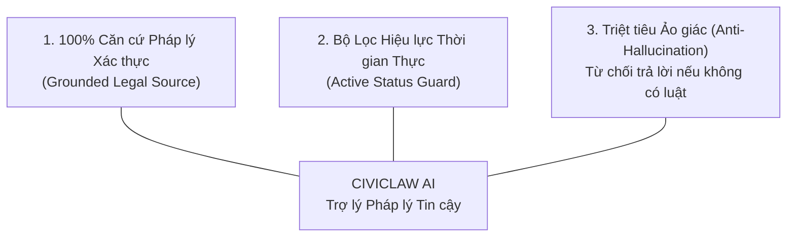
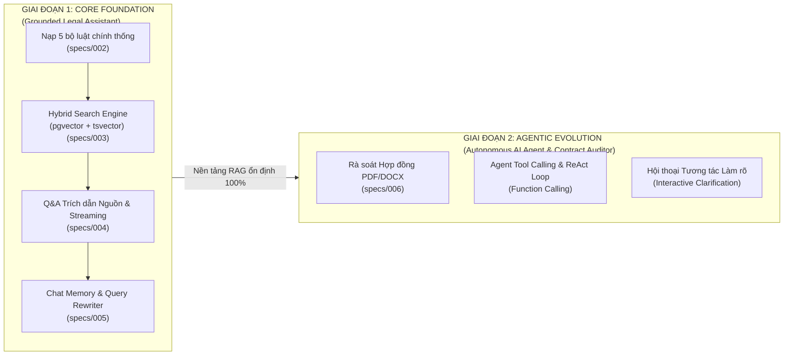
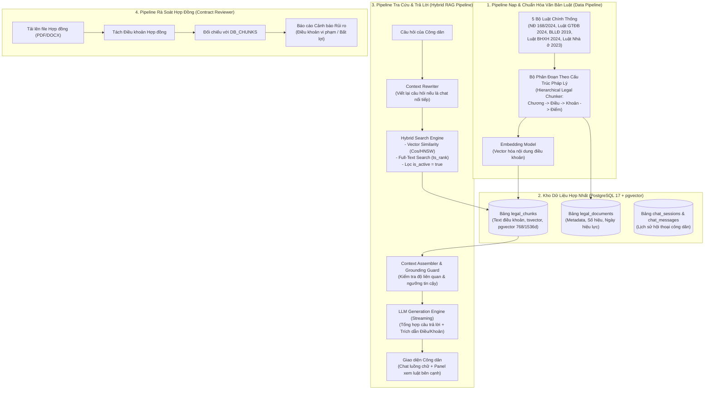
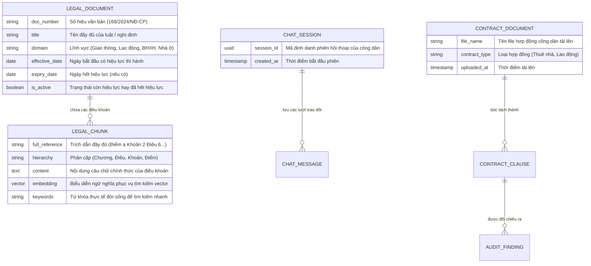

# CivicLaw AI — Master Architectural Specification & Business Blueprint

> **Phiên bản:** 1.0.0 | **Trạng thái:** Active Architecture Master  
> **Tài liệu gốc tham chiếu:** [raw_specification_and_tech_stack.md](file:///d:/civiclaw-ai/docs/references/raw_specification_and_tech_stack.md)  
> **Nguyên tắc vận hành:** Mọi module phát triển tiếp theo đều phải tuân thủ tài liệu Master này và triển khai theo quy trình **Spec-Driven Development (specs/NNN-xxx/)**.

---

## 1. Tầm Nhìn Sản Phẩm & Bài Toán Cốt Lõi (Vision & Core Problems)

### 1.1. Mục tiêu
**CivicLaw AI** là hệ thống trợ lý số thông minh hỗ trợ công dân tra cứu pháp luật đời sống thường nhật (Giao thông, Lao động, BHXH, Nhà ở) và rà soát hợp đồng dân sự cá nhân (Hợp đồng thuê nhà, Hợp đồng lao động).

### 1.2. Ba Trụ Cột Giải Pháp (Three Core Pillars)


1. **Grounded Legal Source:** Mọi câu trả lời của AI bắt buộc phải đính kèm trích dẫn chính xác: *Tên văn bản, Số hiệu, Điều, Khoản, Điểm*.
2. **Active Status Guard:** Hệ thống tự động lọc và chỉ truy xuất các quy định đang còn hiệu lực thi hành, loại bỏ hoàn toàn các văn bản đã hết hiệu lực.
3. **Anti-Hallucination:** Nếu câu hỏi nằm ngoài phạm vi dữ liệu pháp luật hiện có, hệ thống lập tức thông báo không đủ cơ sở dữ liệu thay vì tự suy diễn mức phạt hoặc chế tài.

---

## 2. Phân Kỳ Phát Triển 2 Giai Đoạn (Two-Phase Evolution Roadmap)

Để kiểm soát rủi ro, bám sát triết lý **Ponytail (YAGNI & Minimum Viable Code)** và đảm bảo tính khả thi cao, dự án được phân định rạch ròi thành 2 giai đoạn:



### 2.1. Giai đoạn 1: Core Foundation — Trợ Lý Tra Cứu Pháp Luật Có Căn Cứ
* **Trọng tâm:** Xây dựng "móng nhà" vững chắc — tập trung 100% vào chất lượng dữ liệu sạch, tốc độ truy vấn và độ chính xác của trích dẫn.
* **Phạm vi thực hiện:**
  1. `specs/002-legal-data-ingestion/`: Pipeline bóc tách theo phân cấp `Chương -> Điều -> Khoản -> Điểm`.
  2. `specs/003-hybrid-legal-search/`: Tìm kiếm kết hợp Vector Cosine + Full-Text Search + Lọc `is_active = true`.
  3. `specs/004-legal-qa-citations/`: LLM System Prompt luật sư nghiêm cẩn, trích dẫn Điều/Khoản, Streaming SSE.
  4. `specs/005-chat-session-memory/`: Bộ nhớ hội thoại và tự động viết lại câu hỏi nối tiếp.
* **Tiêu chuẩn hoàn thành (Definition of Done - DoD Phase 1):**
  * Công dân hỏi bất kỳ tình huống nào trong 4 lĩnh vực (Giao thông, Lao động, BHXH, Nhà ở), hệ thống trả lời trong $\le 2$ giây kèm chính xác Số hiệu văn bản, Điều, Khoản.
  * Nếu câu hỏi ngoài phạm vi, AI từ chối trả lời ngay lập tức, không sinh ảo giác.

### 2.2. Giai đoạn 2: Agentic Evolution — AI Agent Tự Chủ & Rà Soát Hợp Đồng
* **Trọng tâm:** Nâng cấp từ "hệ thống hỏi đáp" lên "AI Agent có quyền năng hành động" (Autonomous Reasoning & Action).
* **Phạm vi thực hiện:**
  1. `specs/006-contract-auditor/`: Nhận file PDF/DOCX hợp đồng thuê nhà / thử việc, tự động bóc tách điều khoản và đối chiếu rủi ro 3 mức (Xanh - Vàng - Đỏ).
  2. **Cơ chế Tool Calling (Function Calling):** Agent tự chủ quyết định khi nào cần tra cứu luật giao thông, khi nào cần tra cứu luật lao động, khi nào cần đặt câu hỏi làm rõ cho công dân.
  3. **Vòng lặp ReAct (Reason + Act + Observe):** Cho phép giải quyết các vụ việc pháp lý phức tạp cần tổng hợp từ nhiều nguồn luật khác nhau.
* **Tiêu chuẩn hoàn thành (Definition of Done - DoD Phase 2):**
  * Tải hợp đồng cá nhân lên, Agent tự động xuất bảng đánh giá rủi ro từng điều khoản kèm đề xuất sửa đổi điều khoản an toàn cho công dân trước khi ký.

---

## 3. Kiến Trúc Kỹ Thuật Tổng Thể (System Architecture)

Hệ thống được thiết kế theo kiến trúc **RAG 2 lớp (Hybrid Retrieval-Augmented Generation)** kết hợp giữa tìm kiếm ngữ nghĩa (Vector Search) và tìm kiếm từ khóa chính xác (Full-Text Search) trên nền tảng **PostgreSQL + `pgvector`**.



---

## 4. Mô Hình Dữ Liệu Khái Niệm (Conceptual Data Entities)

> [!NOTE]
> Theo quy chuẩn **Spec-Driven Development (SDD)**, tài liệu Master chỉ định nghĩa **các thực thể nghiệp vụ và nhu cầu thông tin ở mức khái niệm (Conceptual Model)**. Thiết kế chi tiết cấu trúc bảng (Tables, Schema, DDL, Indexing) sẽ được thực hiện linh hoạt trong `plan.md` của từng tính năng cụ thể (`specs/NNN-xxx/`), tuyệt đối không ấn định cứng sớm (tránh bẫy Over-engineering & Premature Optimization).

Hệ thống quản lý 4 nhóm thực thể thông tin cốt lõi:



---

## 5. Phân Rã 5 Khối Logic Nghiệp Vụ Cốt Lõi (Business Logic Breakdown)

Toàn bộ hệ thống được phân rã thành 5 khối nghiệp vụ độc lập, tương ứng với lộ trình chuyển giao sang **Spec-Driven Development (`specs/NNN-xxx/`)**:

```
specs/
├── 002-legal-data-ingestion/    # Khối 1: Chuẩn hóa & Nạp 5 bộ luật gốc
├── 003-hybrid-legal-search/     # Khối 2: Công cụ tìm kiếm Hybrid (Vector + Keyword + Active Filter)
├── 004-legal-qa-citations/      # Khối 3: Luồng hỏi đáp LLM có căn cứ & Streaming
├── 005-chat-session-memory/     # Khối 4: Quản lý phiên hội thoại & Query Rewriting
└── 006-contract-auditor/        # Khối 5: Bộ phân tích & rà soát rủi ro hợp đồng cá nhân
```

### Khối 1: Legal Data Ingestion & Hierarchical Chunker (`specs/002`)
* **Trách nhiệm:** 
  * Tiếp nhận 5 văn bản luật gốc từ `vanban.chinhphu.vn` (định dạng HTML/DOCX/PDF).
  * Xây dựng thuật toán bóc tách chuyên biệt cho văn bản quy phạm pháp luật Việt Nam: Phân rã theo phân cấp chặt chẽ: `Văn bản -> Chương -> Điều -> Khoản -> Điểm`.
  * Gắn nhãn metadata (Số hiệu, Ngày hiệu lực, Lĩnh vực).
  * Tính toán vector embedding và nạp vào database.

### Khối 2: Hybrid Legal Search Engine (`specs/003`)
* **Trách nhiệm:**
  * Nhận query tìm kiếm từ người dùng.
  * Lọc cứng: Chỉ tìm kiếm các văn bản thỏa mãn `is_active = true` và nằm trong `domain` được chọn.
  * Chạy song song:
    1. Vector Cosine Similarity Search qua `pgvector`.
    2. Full-Text Keyword Search qua `tsvector` để bắt chính xác các con số phạt (ví dụ: *"phạt 2 đến 3 triệu"*).
  * Kết hợp điểm số bằng thuật toán **Reciprocal Rank Fusion (RRF)** để chọn ra Top-K điều khoản phù hợp nhất.

### Khối 3: Grounded Legal Q&A & Citation Synthesis (`specs/004`)
* **Trách nhiệm:**
  * Xây dựng System Prompt "Luật sư nghiêm cẩn": Bắt buộc mọi khẳng định đều phải có căn cứ dẫn chiếu từ Top-K chunks được cung cấp.
  * Nếu thông tin không đủ: Trả về thông điệp chuẩn *"Hệ thống không tìm thấy quy định pháp lý tương ứng trong kho dữ liệu hiện tại."*
  * Hỗ trợ Server-Sent Events (SSE) để Streaming câu trả lời từng chữ tới người dùng.

### Khối 4: Multi-turn Chat Memory & Contextual Rewriting (`specs/005`)
* **Trách nhiệm:**
  * Lưu trữ lịch sử câu hỏi - câu trả lời theo `session_id`.
  * Xử lý câu hỏi nối tiếp của công dân (ví dụ: *"Lỗi đó có bị giữ xe không?"* $\rightarrow$ Query Rewriter tự động biên dịch thành: *"Lỗi điều khiển xe máy vượt đèn đỏ có bị tạm giữ phương tiện theo Nghị định 168/2024 không?"* trước khi truy vấn vector).

### Khối 5: Contract Clause Audit & Risk Detection (`specs/006`)
* **Trách nhiệm:**
  * Bóc tách file hợp đồng người dùng tải lên thành từng điều khoản riêng lẻ.
  * Đối chiếu các điều khoản nhạy cảm (Đặt cọc, phạt cọc, bồi thường, thời hạn báo trước khi chấm dứt) với Bộ luật Lao động 2019 và Luật Nhà ở 2023.
  * Đánh dấu 3 mức độ cảnh báo: **Hợp pháp (Xanh)**, **Bất lợi cần đàm phán (Vàng)**, **Trái luật / Vô hiệu (Đỏ)**.

---

## 5. Đánh Giá & Khuyến Nghị Tech Stack (Thực Dụng Theo Triết Lý Ponytail)

Dựa trên tài liệu đặc tả và nguyên tắc tối giản (The 7-Rung Ladder), dưới đây là phân tích và khuyến nghị phương án tối ưu:

| Thành phần | Lựa chọn đề xuất | Lý do & Đánh đổi thực tế |
| :--- | :--- | :--- |
| **Cơ sở dữ liệu** | **PostgreSQL 17 + `pgvector`** | **Cố định & Tối ưu nhất:** Không cần chạy thêm hệ thống vector độc lập (Milvus/Pinecone). 1 CSDL duy nhất giải quyết trọn vẹn cả dữ liệu người dùng lẫn vector. |
| **Backend** | **Node.js / TypeScript** *(Khuyên dùng)* HOẶC **Python (FastAPI)** | • **TypeScript:** Dự án hiện tại đã setup sẵn `package.json`, `vitest`, `typescript`. Chọn TypeScript giúp tái sử dụng 100% hạ tầng hiện tại mà không cần cài thêm Python runtime.<br>• **Python:** Nếu bạn muốn tận dụng thư viện bóc tách PDF chuyên sâu (`pypdf`, `pdfplumber`), Python là lựa chọn vượt trội về xử lý dữ liệu thô. |
| **LLM & Embedding** | **Google Gemini API** (`gemini-2.5-flash` + `gemini-embedding-001`) | **Chi phí 0đ & Cửa sổ ngữ cảnh khổng lồ:** Free Tier cực kỳ hào phóng, đọc hiểu tiếng Việt pháp luật rất tốt, context window 1 triệu tokens giúp đọc toàn bộ hợp đồng dài mà không bị tràn context. |
| **Giao diện** | **Next.js / React + Tailwind CSS** | Trải nghiệm người dùng tốt nhất: Hỗ trợ luồng streaming mượt mà, layout 2 cột (Chat bên trái, Văn bản luật đối chiếu bên phải). |
| **Triển khai** | **Docker Compose** | Đóng gói 1 file `docker-compose.yml` duy nhất khởi chạy PostgreSQL (`pgvector:pg17`), dễ dàng chạy trên bất kỳ máy nào. |

---

## 6. Danh Mục Năng Lực Của AI Agent (Agent Tool Capabilities)

Trong Giai đoạn 2, LLM không chỉ sinh văn bản thụ động mà hoạt động như một **Autonomous Legal Agent** được trang bị các năng lực hành động cụ thể:

| Tên Năng Lực (Tool) | Mục Đích Nghiệp Vụ | Dữ Liệu Đầu Vào | Kết Quả Mong Đợi |
| :--- | :--- | :--- | :--- |
| **Tra cứu điều khoản luật** (`search_legal_rules`) | Tìm kiếm các quy định pháp luật liên quan tới hành vi hoặc câu hỏi của công dân. | Từ khóa, câu hỏi tình huống, khoanh vùng lĩnh vực (Giao thông, Lao động, BHXH, Nhà ở). | Danh sách các đoạn trích Điều/Khoản luật còn hiệu lực kèm trích dẫn. |
| **Kiểm tra trạng thái hiệu lực** (`check_law_status`) | Xác minh một văn bản hoặc điều luật cụ thể hiện còn hiệu lực hay đã bị bãi bỏ/sửa đổi. | Số hiệu văn bản (NĐ 168/2024), số thứ tự Điều. | Trạng thái: Còn hiệu lực, Hết hiệu lực, hoặc Bị sửa đổi bởi văn bản nào. |
| **Rà soát điều khoản hợp đồng** (`audit_contract_clause`) | Đối chiếu một điều khoản trong hợp đồng cá nhân với các quy định pháp luật hiện hành. | Nội dung điều khoản hợp đồng, loại hợp đồng (Thuê nhà, Lao động). | Đánh giá 3 mức (Hợp pháp, Bất lợi, Trái luật) kèm căn cứ pháp lý và gợi ý sửa đổi. |
| **Hỏi lại để làm rõ tình tiết** (`ask_clarification`) | Đặt câu hỏi tương tác ngược lại cho công dân khi vụ việc còn thiếu dữ kiện pháp lý trọng yếu. | Câu hỏi làm rõ, khía cạnh pháp lý cần xác minh. | Thu nhận thông tin bổ sung từ công dân để hoàn tất suy luận. |

> [!TIP]
> Cấu trúc schema kỹ thuật cụ thể (Function calling parameters, types, JSON Schema) của từng tool sẽ được thiết kế chi tiết trong `plan.md` của Giai đoạn 2 (`specs/006-xxx/`), tuân thủ đúng quy chuẩn SDD.

---

## 7. Lộ Trình Triển Khai (Roadmap)


