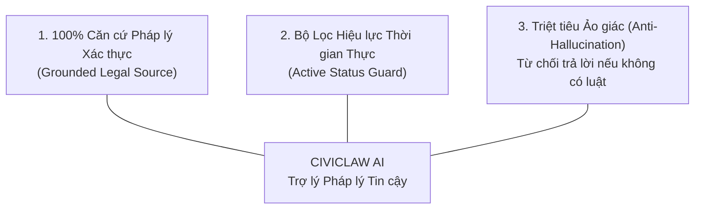
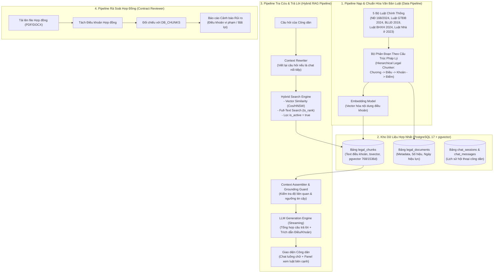
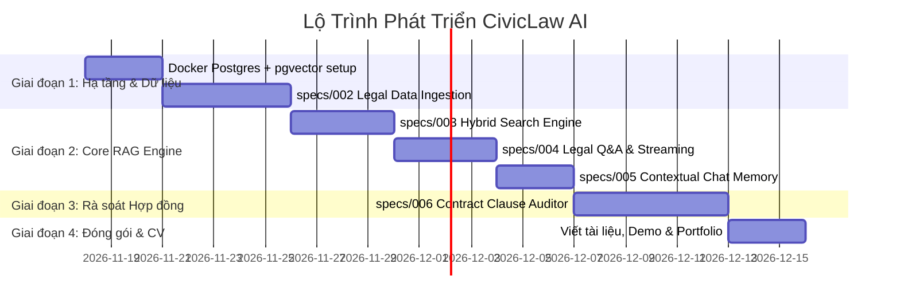

# CivicLaw AI — Master Architectural Specification & Business Blueprint

> **Phiên bản:** 1.0.0 | **Trạng thái:** Active Architecture Master  
> **Tài liệu gốc tham chiếu:** [raw_specification_and_tech_stack.md](file:///d:/civiclaw-ai/docs/references/raw_specification_and_tech_stack.md)  
> **Nguyên tắc vận hành:** Mọi module phát triển tiếp theo đều phải tuân thủ tài liệu Master này và triển khai theo quy trình **Spec-Driven Development (specs/NNN-xxx/)**.

---

## 1. Tầm Nhìn Sản Phẩm & Bài Toán Cốt Lõi (Vision & Core Problems)

### 1.1. Mục tiêu
**CivicLaw AI** là hệ thống trợ lý số thông minh hỗ trợ công dân tra cứu pháp luật đời sống thường nhật (Giao thông, Lao động, BHXH, Nhà ở) và rà soát hợp đồng dân sự cá nhân (Hợp đồng thuê nhà, Hợp đồng lao động).

### 1.2. Ba Trụ Cột Giải Pháp (Three Core Pillars)


1. **Grounded Legal Source:** Mọi câu trả lời của AI bắt buộc phải đính kèm trích dẫn chính xác: *Tên văn bản, Số hiệu, Điều, Khoản, Điểm*.
2. **Active Status Guard:** Hệ thống tự động lọc và chỉ truy xuất các quy định đang còn hiệu lực thi hành, loại bỏ hoàn toàn các văn bản đã hết hiệu lực.
3. **Anti-Hallucination:** Nếu câu hỏi nằm ngoài phạm vi dữ liệu pháp luật hiện có, hệ thống lập tức thông báo không đủ cơ sở dữ liệu thay vì tự suy diễn mức phạt hoặc chế tài.

---

## 2. Kiến Trúc Kỹ Thuật Tổng Thể (System Architecture)

Hệ thống được thiết kế theo kiến trúc **RAG 2 lớp (Hybrid Retrieval-Augmented Generation)** kết hợp giữa tìm kiếm ngữ nghĩa (Vector Search) và tìm kiếm từ khóa chính xác (Full-Text Search) trên nền tảng **PostgreSQL + `pgvector`**.



---

## 3. Thiết Kế Cơ Sở Dữ Liệu Cốt Lõi (Database Schema)

Hệ thống sử dụng PostgreSQL 17 với extension `pgvector` để quản lý đồng nhất cả dữ liệu quan hệ và vector:

```sql
-- 1. Bật extension pgvector
CREATE EXTENSION IF NOT EXISTS vector;
CREATE EXTENSION IF NOT EXISTS "uuid-ossp";

-- 2. Bảng quản lý văn bản quy phạm pháp luật
CREATE TABLE legal_documents (
    id UUID PRIMARY KEY DEFAULT uuid_generate_v4(),
    doc_number VARCHAR(100) NOT NULL UNIQUE,       -- Ví dụ: '168/2024/NĐ-CP'
    title TEXT NOT NULL,                           -- Tên đầy đủ của văn bản
    domain VARCHAR(50) NOT NULL,                   -- 'TRAFFIC', 'LABOR', 'SOCIAL_INSURANCE', 'HOUSING'
    issuer VARCHAR(150),                           -- Cơ quan ban hành (Chính phủ, Quốc hội)
    issue_date DATE NOT NULL,                      -- Ngày ban hành
    effective_date DATE NOT NULL,                  -- Ngày có hiệu lực
    expiry_date DATE,                              -- Ngày hết hiệu lực (NULL nếu còn hiệu lực)
    is_active BOOLEAN GENERATED ALWAYS AS (
        expiry_date IS NULL OR expiry_date >= CURRENT_DATE
    ) STORED,                                      -- Trạng thái hiệu lực tự động
    source_url TEXT,                               -- Đường dẫn cổng thông tin chính phủ
    created_at TIMESTAMP WITH TIME ZONE DEFAULT NOW()
);

-- 3. Bảng phân đoạn điều khoản pháp lý (Chunks + Vectors)
CREATE TABLE legal_chunks (
    id UUID PRIMARY KEY DEFAULT uuid_generate_v4(),
    document_id UUID REFERENCES legal_documents(id) ON DELETE CASCADE,
    chapter VARCHAR(100),                          -- Ví dụ: 'Chương II'
    article VARCHAR(100) NOT NULL,                 -- Ví dụ: 'Điều 6'
    clause VARCHAR(100),                           -- Ví dụ: 'Khoản 2'
    point VARCHAR(10),                             -- Ví dụ: 'Điểm a'
    full_reference TEXT NOT NULL,                  -- 'Điểm a Khoản 2 Điều 6 Nghị định 168/2024/NĐ-CP'
    content TEXT NOT NULL,                         -- Nội dung câu chữ chính thức của điều khoản
    keywords TEXT[],                               -- Từ khóa nhận diện nhanh (ví dụ: ['nồng độ cồn', 'xe máy'])
    embedding vector(768),                         -- Vector embedding (768 chiều cho Gemini, 1536 cho OpenAI)
    search_vector tsvector GENERATED ALWAYS AS (
        to_tsvector('simple', content || ' ' || full_reference)
    ) STORED,                                      -- Chỉ mục tìm kiếm từ khóa chính xác
    created_at TIMESTAMP WITH TIME ZONE DEFAULT NOW()
);

-- Chỉ mục tối ưu tốc độ tìm kiếm
CREATE INDEX idx_legal_chunks_embedding ON legal_chunks USING hnsw (embedding vector_cosine_ops);
CREATE INDEX idx_legal_chunks_search_vector ON legal_chunks USING gin (search_vector);
CREATE INDEX idx_legal_documents_domain_active ON legal_documents(domain, is_active);
```

---

## 4. Phân Rã 5 Khối Logic Nghiệp Vụ Cốt Lõi (Business Logic Breakdown)

Toàn bộ hệ thống được phân rã thành 5 khối nghiệp vụ độc lập, tương ứng với lộ trình chuyển giao sang **Spec-Driven Development (`specs/NNN-xxx/`)**:

```
specs/
├── 002-legal-data-ingestion/    # Khối 1: Chuẩn hóa & Nạp 5 bộ luật gốc
├── 003-hybrid-legal-search/     # Khối 2: Công cụ tìm kiếm Hybrid (Vector + Keyword + Active Filter)
├── 004-legal-qa-citations/      # Khối 3: Luồng hỏi đáp LLM có căn cứ & Streaming
├── 005-chat-session-memory/     # Khối 4: Quản lý phiên hội thoại & Query Rewriting
└── 006-contract-auditor/        # Khối 5: Bộ phân tích & rà soát rủi ro hợp đồng cá nhân
```

### Khối 1: Legal Data Ingestion & Hierarchical Chunker (`specs/002`)
* **Trách nhiệm:** 
  * Tiếp nhận 5 văn bản luật gốc từ `vanban.chinhphu.vn` (định dạng HTML/DOCX/PDF).
  * Xây dựng thuật toán bóc tách chuyên biệt cho văn bản quy phạm pháp luật Việt Nam: Phân rã theo phân cấp chặt chẽ: `Văn bản -> Chương -> Điều -> Khoản -> Điểm`.
  * Gắn nhãn metadata (Số hiệu, Ngày hiệu lực, Lĩnh vực).
  * Tính toán vector embedding và nạp vào database.

### Khối 2: Hybrid Legal Search Engine (`specs/003`)
* **Trách nhiệm:**
  * Nhận query tìm kiếm từ người dùng.
  * Lọc cứng: Chỉ tìm kiếm các văn bản thỏa mãn `is_active = true` và nằm trong `domain` được chọn.
  * Chạy song song:
    1. Vector Cosine Similarity Search qua `pgvector`.
    2. Full-Text Keyword Search qua `tsvector` để bắt chính xác các con số phạt (ví dụ: *"phạt 2 đến 3 triệu"*).
  * Kết hợp điểm số bằng thuật toán **Reciprocal Rank Fusion (RRF)** để chọn ra Top-K điều khoản phù hợp nhất.

### Khối 3: Grounded Legal Q&A & Citation Synthesis (`specs/004`)
* **Trách nhiệm:**
  * Xây dựng System Prompt "Luật sư nghiêm cẩn": Bắt buộc mọi khẳng định đều phải có căn cứ dẫn chiếu từ Top-K chunks được cung cấp.
  * Nếu thông tin không đủ: Trả về thông điệp chuẩn *"Hệ thống không tìm thấy quy định pháp lý tương ứng trong kho dữ liệu hiện tại."*
  * Hỗ trợ Server-Sent Events (SSE) để Streaming câu trả lời từng chữ tới người dùng.

### Khối 4: Multi-turn Chat Memory & Contextual Rewriting (`specs/005`)
* **Trách nhiệm:**
  * Lưu trữ lịch sử câu hỏi - câu trả lời theo `session_id`.
  * Xử lý câu hỏi nối tiếp của công dân (ví dụ: *"Lỗi đó có bị giữ xe không?"* $\rightarrow$ Query Rewriter tự động biên dịch thành: *"Lỗi điều khiển xe máy vượt đèn đỏ có bị tạm giữ phương tiện theo Nghị định 168/2024 không?"* trước khi truy vấn vector).

### Khối 5: Contract Clause Audit & Risk Detection (`specs/006`)
* **Trách nhiệm:**
  * Bóc tách file hợp đồng người dùng tải lên thành từng điều khoản riêng lẻ.
  * Đối chiếu các điều khoản nhạy cảm (Đặt cọc, phạt cọc, bồi thường, thời hạn báo trước khi chấm dứt) với Bộ luật Lao động 2019 và Luật Nhà ở 2023.
  * Đánh dấu 3 mức độ cảnh báo: **Hợp pháp (Xanh)**, **Bất lợi cần đàm phán (Vàng)**, **Trái luật / Vô hiệu (Đỏ)**.

---

## 5. Đánh Giá & Khuyến Nghị Tech Stack (Thực Dụng Theo Triết Lý Ponytail)

Dựa trên tài liệu đặc tả và nguyên tắc tối giản (The 7-Rung Ladder), dưới đây là phân tích và khuyến nghị phương án tối ưu:

| Thành phần | Lựa chọn đề xuất | Lý do & Đánh đổi thực tế |
| :--- | :--- | :--- |
| **Cơ sở dữ liệu** | **PostgreSQL 17 + `pgvector`** | **Cố định & Tối ưu nhất:** Không cần chạy thêm hệ thống vector độc lập (Milvus/Pinecone). 1 CSDL duy nhất giải quyết trọn vẹn cả dữ liệu người dùng lẫn vector. |
| **Backend** | **Node.js / TypeScript** *(Khuyên dùng)* HOẶC **Python (FastAPI)** | • **TypeScript:** Dự án hiện tại đã setup sẵn `package.json`, `vitest`, `typescript`. Chọn TypeScript giúp tái sử dụng 100% hạ tầng hiện tại mà không cần cài thêm Python runtime.<br>• **Python:** Nếu bạn muốn tận dụng thư viện bóc tách PDF chuyên sâu (`pypdf`, `pdfplumber`), Python là lựa chọn vượt trội về xử lý dữ liệu thô. |
| **LLM & Embedding** | **Google Gemini API** (`gemini-2.5-flash` + `gemini-embedding-001`) | **Chi phí 0đ & Cửa sổ ngữ cảnh khổng lồ:** Free Tier cực kỳ hào phóng, đọc hiểu tiếng Việt pháp luật rất tốt, context window 1 triệu tokens giúp đọc toàn bộ hợp đồng dài mà không bị tràn context. |
| **Giao diện** | **Next.js / React + Tailwind CSS** | Trải nghiệm người dùng tốt nhất: Hỗ trợ luồng streaming mượt mà, layout 2 cột (Chat bên trái, Văn bản luật đối chiếu bên phải). |
| **Triển khai** | **Docker Compose** | Đóng gói 1 file `docker-compose.yml` duy nhất khởi chạy PostgreSQL (`pgvector:pg17`), dễ dàng chạy trên bất kỳ máy nào. |

---

## 6. Lộ Trình Triển Khai (Roadmap)


