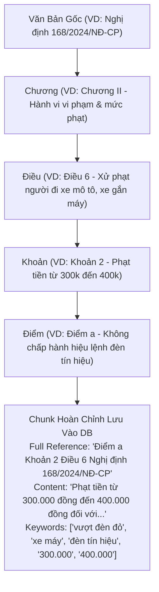

# Phân Rã Nghiệp Vụ 01: Pipeline Nạp & Phân Đoạn Văn Bản Luật (Data Ingestion)

> **Mã quy chuẩn SDD tương ứng:** `specs/002-legal-data-ingestion/`  
> **Tài liệu tham chiếu:** [docs/00-master-architecture.md](file:///d:/civiclaw-ai/docs/00-master-architecture.md)

---

## 1. Mục Tiêu Nghiệp Vụ
Tiếp nhận, làm sạch và bóc tách 5 bộ văn bản quy phạm pháp luật nền tảng của Việt Nam thành các đơn vị phân đoạn (Chunks) có cấu trúc ngữ nghĩa hoàn chỉnh để phục vụ tìm kiếm chính xác.

## 2. Danh Mục 5 Văn Bản Luật Cần Xử Lý
1. **Nghị định 168/2024/NĐ-CP:** Quy định xử phạt vi phạm hành chính trong lĩnh vực giao thông đường bộ; trừ điểm GPLX.
2. **Luật Trật tự, an toàn giao thông đường bộ 2024 (36/2024/QH15):** Quy tắc và chế độ tham gia giao thông.
3. **Bộ luật Lao động 2019 (45/2019/QH14):** Hợp đồng lao động, tiền lương, kỷ luật, trợ cấp thôi việc.
4. **Luật Bảo hiểm xã hội 2024 (41/2024/QH15):** Chế độ ốm đau, thai sản, hưu trí, BHXH một lần.
5. **Luật Nhà ở 2023 (27/2023/QH15):** Thuê nhà, đặt cọc, quyền và nghĩa vụ các bên trong hợp đồng thuê.

## 3. Thuật Toán Bóc Tách Theo Cấu Trúc Pháp Lý (Legal Hierarchical Chunker)
Văn bản luật Việt Nam có cấu trúc ngữ nghĩa chặt chẽ. Tuyệt đối **không dùng kỹ thuật cắt đoạn cố định theo số ký tự (Fixed-size chunking 500 ký tự)** vì sẽ làm đứt gãy câu văn và mất ngữ cảnh.

## 4. Dữ Liệu Đầu Ra (Outputs)
Mỗi chunk được lưu trữ kèm:
* `document_id`: Liên kết tới văn bản cha.
* `full_reference`: Chuỗi trích dẫn đầy đủ (dùng để trích dẫn vào câu trả lời).
* `content`: Nội dung pháp lý chính xác.
* `embedding`: Vector đại diện ngữ nghĩa (768 chiều).
* `keywords`: Mảng từ khóa phát hiện tự động.
