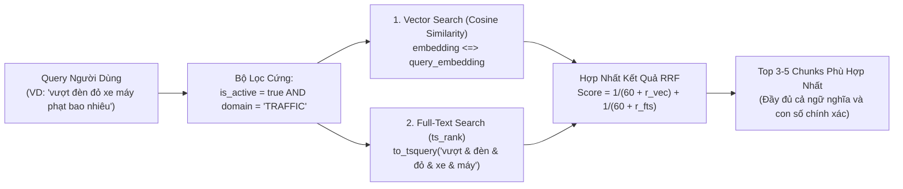

# Phân Rã Nghiệp Vụ 02: Tìm Kiếm Kết Hợp (Hybrid Search & Retrieval Engine)

> **Mã quy chuẩn SDD tương ứng:** `specs/003-hybrid-legal-search/`  
> **Tài liệu tham chiếu:** [docs/00-master-architecture.md](file:///d:/civiclaw-ai/docs/00-master-architecture.md)

---

## 1. Vấn Đề Nghiệp Vụ Cần Giải Quyết
Trong lĩnh vực pháp lý:
* Nếu **chỉ dùng Vector Search (Tìm kiếm ngữ nghĩa):** Rất giỏi hiểu ý nghĩa câu hỏi ("uống bia đi xe máy phạt bao nhiêu"), nhưng lại kém khi tìm chính xác con số phạt cụ thể hoặc số hiệu điều luật ("Điều 6", "Nghị định 168").
* Nếu **chỉ dùng Keyword Search (Full-Text Search):** Bắt đúng từ khóa chính xác, nhưng người dân thường dùng ngôn ngữ đời thường (ví dụ: "thổi cồn", "vượt đèn vàng") vốn không xuất hiện nguyên văn trong văn bản luật ("nồng độ cồn", "tín hiệu đèn vàng").

## 2. Giải Pháp: Hybrid Retrieval với Reciprocal Rank Fusion (RRF)

Hệ thống kết hợp song song cả 2 phương thức trên PostgreSQL:

## 3. Tiêu Chí Nghiệm Thu Bắt Buộc
* Không bao giờ trả về văn bản đã có `expiry_date < CURRENT_DATE`.
* Thời gian phản hồi truy vấn retrieval phải $\le 150\text{ms}$.
