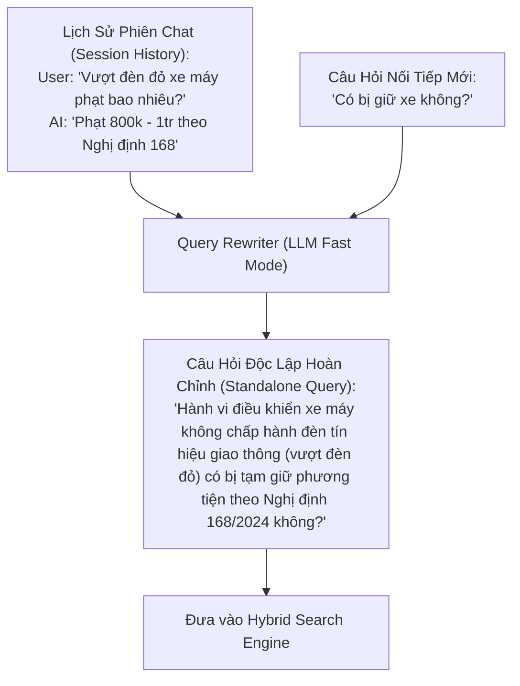

# Phân Rã Nghiệp Vụ 04: Quản Lý Phiên Hội Thoại & Tái Cấu Trúc Câu Hỏi (Chat Memory & Query Rewriter)

> **Mã quy chuẩn SDD tương ứng:** `specs/005-chat-session-memory/`  
> **Tài liệu tham chiếu:** [docs/00-master-architecture.md](file:///d:/civiclaw-ai/docs/00-master-architecture.md)

---

## 1. Vấn Đề Nghiệp Vụ
Người dùng khi chat thường đặt câu hỏi ngắn nối tiếp câu hỏi trước:
* *Lượt 1:* "Xe máy vượt đèn đỏ phạt bao nhiêu?" $\rightarrow$ AI trả lời: "Phạt 800k - 1 triệu".
* *Lượt 2:* "Có bị giữ xe không?"
* **Vấn đề:** Nếu đưa câu "Có bị giữ xe không?" thẳng vào bộ tìm kiếm Vector, vector sẽ tìm các bài viết chung chung về tạm giữ xe mà không biết đang nói về xe máy vượt đèn đỏ!

## 2. Giải Pháp: Query Rewriting Pipeline

## 3. Quản Lý Phiên (Session Management)
* Quản lý bằng `session_id` (UUID).
* Giới hạn ngữ cảnh (Sliding Window): Chỉ nạp 5-10 lượt hội thoại gần nhất để tiết kiệm token và tránh nhiễu thông tin.
