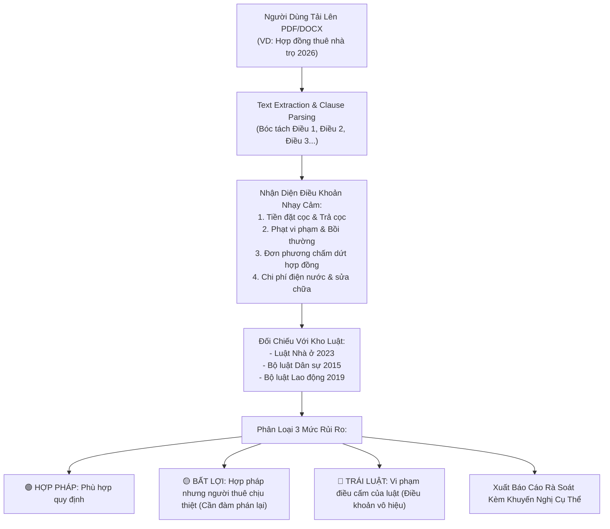

# Phân Rã Nghiệp Vụ 05: Rà Soát Hợp Đồng Cá Nhân & Phát Hiện Rủi Ro (Contract Auditor)

> **Mã quy chuẩn SDD tương ứng:** `specs/006-contract-auditor/`  
> **Tài liệu tham chiếu:** [docs/00-master-architecture.md](file:///d:/civiclaw-ai/docs/00-master-architecture.md)

---

## 1. Mục Tiêu Nghiệp Vụ
Cho phép người dùng tải lên file hợp đồng (Hợp đồng thuê nhà trọ, Hợp đồng thử việc/lao động) dạng PDF hoặc DOCX; hệ thống tự động bóc tách điều khoản, đối chiếu với quy định luật hiện hành và đưa ra bảng đánh giá rủi ro trước khi ký.

## 2. Quy Trình Phân Tích Hợp Đồng (Contract Auditing Flow)

## 3. Các Tình Huống Cảnh Báo Điển Hình
* **Trường hợp 1 (Trái luật - Đỏ):** Hợp đồng ghi: *"Chủ nhà có quyền khóa cửa, giữ đồ đạc của bên thuê nếu chậm trả tiền phòng 3 ngày mà không cần báo trước"*. $\rightarrow$ Cảnh báo: Trái quy định pháp luật về chiếm giữ tài sản bất hợp pháp.
* **Trường hợp 2 (Bất lợi - Vàng):** Hợp đồng ghi: *"Mức phạt vi phạm hợp đồng là 50% tổng giá trị hợp đồng"*. $\rightarrow$ Cảnh báo: Mức phạt quá cao so với thông lệ thị trường, cần đàm phán giảm xuống 8-10%.
