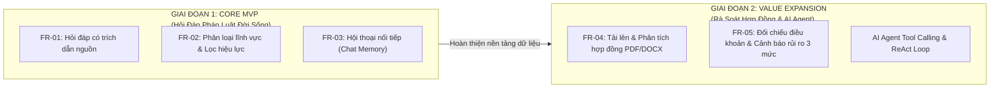

# CivicLaw AI — Product Requirements Document (PRD)

> **Tài liệu tham chiếu gốc:** [docs/references/raw_specification_and_tech_stack.md](file:///d:/civiclaw-ai/docs/references/raw_specification_and_tech_stack.md)  
> **Góc nhìn (Perspective):** Business Analyst (BA) & High-Level Architecture  
> **Nguyên tắc cốt lõi:** Tài liệu này chỉ cung cấp **Bối cảnh vĩ mô (Macro Context)** và **Yêu cầu sản phẩm**. Mọi thiết kế kỹ thuật chi tiết (Database Schema, Tables, APIs, Code) **bắt buộc phải nằm trong từng `specs/NNN-xxx/`** theo đúng quy chuẩn Spec-Driven Development (SDD).

---

## 1. Bối Cảnh & Mục Tiêu Nghiệp Vụ (Business Context)

### 1.1. Vấn Đề Của Người Dùng (Pain Points)
* **Khó tiếp cận văn bản gốc:** Văn bản luật dài, nhiều thuật ngữ chuyên ngành khiến người dân khó tự tra cứu nhanh trong các tình huống đời sống (bị xử phạt giao thông, nghỉ việc, hưởng BHXH, ký hợp đồng thuê nhà).
* **Rủi ro thông tin lỗi thời:** Tìm kiếm trên mạng dễ gặp các bài viết cũ trích dẫn nghị định/luật đã hết hiệu lực.
* **Hạn chế của AI thông thường (ChatGPT/Gemini thuần):** Dễ gặp tình trạng "ảo giác" (tự suy diễn mức phạt hoặc điều luật không có thật) và không đưa ra được căn cứ pháp lý chính xác.

### 1.2. Giá Trị Cốt Lõi Mang Lại (Value Proposition)
* Cung cấp kênh hỏi đáp bằng ngôn ngữ tự nhiên, trả lời ngắn gọn, dễ hiểu dựa **100% trên kho văn bản pháp luật chính thống** được nạp vào hệ thống.
* Mọi câu trả lời bắt buộc đính kèm trích dẫn cụ thể (*Điều, Khoản, Số hiệu văn bản*) và chỉ truy xuất các quy định đang còn hiệu lực thi hành.
* Hỗ trợ người dùng tải lên hợp đồng cá nhân (thuê trọ, lao động) để tự động rà soát các điều khoản bất lợi hoặc trái quy định hiện hành.

### 1.3. Đối Tượng Người Dùng Mục Tiêu (Target Personas)
1. **Người tham gia giao thông:** Cần tra cứu nhanh mức phạt vi phạm, hình thức xử phạt bổ sung và số điểm bị trừ trên GPLX.
2. **Người lao động:** Cần tìm hiểu quyền lợi hợp đồng lao động, quy định thử việc, tăng ca, trợ cấp thôi việc và chế độ BHXH.
3. **Người đi thuê nhà / Cá nhân giao dịch dân sự:** Cần kiểm tra tính hợp pháp của các điều khoản đặt cọc, phạt cọc, đơn phương chấm dứt hợp đồng trước khi đặt bút ký.

---

## 2. Phạm Vi & Lộ Trình 2 Giai Đoạn (Product Scope & Roadmap)

### 2.1. Giai đoạn 1 — Core MVP (Hỏi đáp Pháp luật Đời sống)
* **FR-01 — Hỏi đáp có trích dẫn (Grounded Legal Q&A):** Người dùng đặt câu hỏi đời sống; hệ thống tìm kiếm các đoạn luật liên quan nhất và tổng hợp câu trả lời kèm nguồn trích dẫn chính xác (*Tên văn bản, Điều, Khoản*).
* **FR-02 — Phân loại & Lọc ngữ cảnh (Domain & Status Filtering):** Cho phép khoanh vùng lĩnh vực tra cứu (Giao thông, Lao động, BHXH, Nhà ở) và tự động loại bỏ các văn bản đã hết hiệu lực.
* **FR-03 — Hội thoại nối tiếp (Contextual Chat Memory):** Ghi nhớ ngữ cảnh trong phiên trò chuyện để hiểu các câu hỏi nối tiếp của người dùng.

### 2.2. Giai đoạn 2 — Mở rộng Giá trị (Contract Reviewer & AI Agent)
* **FR-04 — Tải lên & Phân tích Hợp đồng:** Cho phép người dùng tải lên file hợp đồng cá nhân (PDF/DOCX) và bóc tách thành từng điều khoản riêng lẻ.
* **FR-05 — Đối chiếu & Cảnh báo Rủi ro:** Tự động đối chiếu từng điều khoản với kho luật và đánh dấu 3 mức: Hợp pháp (Xanh), Bất lợi cần đàm phán (Vàng), Trái luật / Vô hiệu (Đỏ).
* **Agentic Capabilities:** Trang bị cơ chế Tool Calling và ReAct loop để trợ lý tự động lập kế hoạch tra cứu và hỏi lại công dân khi thiếu dữ kiện.

### 2.3. Yêu cầu Phi chức năng (Non-Functional Requirements)
* **Độ tin cậy (Groundedness):** Nếu thông tin không nằm trong kho dữ liệu luật, hệ thống phải từ chối trả lời thay vì tự suy đoán.
* **Trải nghiệm phản hồi (Responsiveness):** Hỗ trợ phản hồi dạng luồng chữ chạy dần (Streaming qua SSE).
* **Quyền riêng tư (Privacy):** Tài liệu hợp đồng cá nhân chỉ phục vụ phân tích trong phiên làm việc, không dùng để huấn luyện mô hình.

---

## 3. Nguồn Dữ Liệu Đầu Vào (Reference Data Sources)

Toàn bộ dữ liệu được tải từ **Cổng thông tin điện tử Chính phủ (`vanban.chinhphu.vn`)**:

| Lĩnh vực | Tên văn bản & Số hiệu | Vai trò trong sản phẩm |
| :--- | :--- | :--- |
| **Giao thông (Mức phạt)** | Nghị định 168/2024/NĐ-CP | Tra cứu mức phạt vi phạm giao thông & trừ điểm GPLX. |
| **Giao thông (Luật gốc)** | Luật Trật tự, an toàn giao thông đường bộ 2024 (`36/2024/QH15`) | Quy tắc tham gia giao thông đường bộ hiện hành. |
| **Lao động & Hợp đồng** | Bộ luật Lao động 2019 (`45/2019/QH14`) | Tra cứu quyền lợi người lao động & đối chiếu HĐLĐ. |
| **Bảo hiểm xã hội** | Luật Bảo hiểm xã hội 2024 (`41/2024/QH15`) | Tra cứu chế độ BHXH một lần, thai sản, hưu trí. |
| **Nhà ở & Thuê trọ** | Luật Nhà ở 2023 (`27/2023/QH15`) | Rà soát điều khoản đặt cọc, thuê nhà ở trong hợp đồng. |

---

## 4. Định Hướng Kiến Trúc & Công Nghệ (Tech Stack Options)

* **Cơ sở dữ liệu cốt lõi (Cố định):** **PostgreSQL 17 + `pgvector`** (chạy Docker). Lưu trữ hợp nhất dữ liệu quan hệ (văn bản, hiệu lực, lịch sử chat) và vector embedding.
* **Mô hình AI:** **Google Gemini API** (`gemini-2.5-flash` + `gemini-embedding-001`) — Chi phí 0đ, context 1M tokens, tiếng Việt xuất sắc.
* **Backend:** Lựa chọn giữa **Node.js/TypeScript** (thống nhất với repo hiện tại) hoặc **Python/FastAPI** (mạnh về parse PDF).
* **Frontend:** **Next.js / React + Tailwind CSS** (giao diện chat hiện đại, hỗ trợ streaming).

---

## 5. Quy Chuẩn Liên Kết Sang Spec-Driven Development (`specs/`)

> [!IMPORTANT]
> **Nguyên tắc bất biến:** Tài liệu PRD này KHÔNG can thiệp vào việc thiết kế cấu trúc bảng Database hay viết code.  
> Khi bắt đầu thực hiện bất kỳ tính năng nào từ PRD:
> 1. Sử dụng template tại `specs/TEMPLATE/` để tạo thư mục tính năng mới: `specs/NNN-<tên-tính-năng>/`.
> 2. `spec.md`: Định nghĩa yêu cầu chi tiết, làm rõ câu hỏi (Clarify) và tiêu chí BDD (Given-When-Then).
> 3. `plan.md`: **Tại đây mới thiết kế kỹ thuật chi tiết**, gồm cấu trúc bảng CSDL (Tables, Columns), thuật toán xử lý và API contracts.
> 4. `tasks.md`: Chia nhỏ danh sách công việc.
> 5. `tests/`: Viết kiểm thử trước, sau đó mới viết mã thực thi (`src/`).
