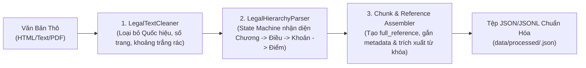

# Kế hoạch Kỹ thuật: Pipeline Nạp & Phân Đoạn Văn Bản Luật (Legal Data Ingestion Engine)

## 1. Thế Nào (Kiến Trúc & Giải Pháp Kỹ Thuật)

Hệ thống bóc tách văn bản luật được thiết kế theo mô hình **Pipeline 3 giai đoạn (Three-Stage Pipeline)** đảm bảo tính thuần khiết (*Deterministic*), dễ unit test và độc lập với CSDL:



## 2. Mô Hình Dữ Liệu & Interfaces (Types)

```typescript
export type LegalDomain = 'TRAFFIC' | 'LABOR' | 'SOCIAL_INSURANCE' | 'HOUSING';

export interface LegalDocumentMetadata {
  docNumber: string;         // '168/2024/NĐ-CP'
  title: string;             // 'Nghị định quy định xử phạt vi phạm hành chính...'
  domain: LegalDomain;       // 'TRAFFIC'
  issueDate: string;         // '2024-12-26'
  effectiveDate: string;     // '2025-01-01'
  expiryDate?: string;       // null nếu còn hiệu lực
  isActive: boolean;         // true/false
  sourceUrl?: string;        // 'https://vanban.chinhphu.vn/...'
}

export interface LegalChunk {
  id: string;                // Hash duy nhất tạo từ docNumber + fullReference
  docNumber: string;         // '168/2024/NĐ-CP'
  domain: LegalDomain;       // 'TRAFFIC'
  chapter?: string;          // 'Chương II'
  article: string;           // 'Điều 6'
  clause?: string;           // 'Khoản 2'
  point?: string;            // 'Điểm a'
  fullReference: string;     // 'Điểm a Khoản 2 Điều 6 Nghị định 168/2024/NĐ-CP'
  content: string;           // Nội dung đầy đủ kèm ngữ cảnh Điều/Khoản
  keywords: string[];        // Từ khóa tự động bóc tách (tiền phạt, phương tiện...)
}
```

## 3. Thuật Toán Bóc Tách (Hierarchical Regex & State Machine)

1. **Làm sạch (Text Cleaning):**
   * Regex xóa tiêu ngữ: `/CỘNG HÒA XÃ HỘI CHỦ NGHĨA VIỆT NAM[\s\S]*?Độc lập - Tự do - Hạnh phúc/gi`.
   * Regex xóa số trang: `/Trang\s+\d+(\/\d+)?/gi` hoặc `/^\s*\d+\s*$/gm`.
2. **Nhận diện phân cấp:**
   * **Điều:** `/^Điều\s+(\d+)[\.:]\s*(.+)$/m`
   * **Khoản:** `/^(\d+)\.\s*(.+)$/m` hoặc `/^Khoản\s+(\d+)[\.:]\s*(.+)$/m`
   * **Điểm:** `/^([a-zđ])\)\s*(.+)$/m`
3. **Bảo toàn ngữ cảnh (Context Preservation):**
   * Khi tạo chunk cho `Điểm a Khoản 2 Điều 6`, nội dung `content` phải bao gồm:
     `[Tiêu đề Điều 6] + [Nội dung mức phạt chung của Khoản 2] + [Hành vi vi phạm cụ thể của Điểm a]`.
   * Tránh tình trạng chunk chỉ có cụm từ cụt lủn: *"a) Không chấp hành hiệu lệnh..."* mà không biết là phạt bao nhiêu tiền và đối với phương tiện gì!
4. **Trích xuất từ khóa (Keyword Extractor):**
   * Regex bắt các con số tiền phạt: `/\b\d+(\.\d+)?\s*(đồng|triệu|nghìn)\b/gi`.
   * Bắt các từ khóa phương tiện/chủ thể: `/(xe mô tô|xe gắn máy|ô tô|người đi bộ|người lao động|người sử dụng lao động)/gi`.

## 4. Xử Lý Trường Hợp Biên (Edge Cases)
* **Điều không có Khoản:** Toàn bộ Điều tạo thành 1 chunk duy nhất.
* **Khoản không có Điểm:** Toàn bộ Khoản tạo thành 1 chunk.
* **Bảng biểu mức phạt:** Chuẩn hóa các dòng bảng thành câu văn hoàn chỉnh có chủ ngữ và vị ngữ.
