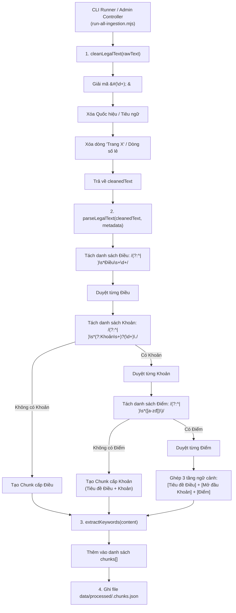

# Bước 2 & Bước 3: Kế Hoạch Kỹ Thuật — 001: Legal Data Ingestion Pipeline

---

# PHẦN A: BƯỚC 2 — KIẾN TRÚC (SYSTEM ARCHITECTURE)

## 1. Hợp đồng giữa các Component (Component Contracts)

```mermaid
flowchart LR
    subgraph InputSource ["Kho Dữ Liệu Gốc (data/raw/)"]
        RawPDF["Bản PDF Gốc (Scan mộc đỏ)\n(Lưu trữ chứng cứ)"]
        RawTxt["Bản Text Toàn Văn Chuẩn Hóa\n(vanban.chinhphu.vn)"]
    end

    subgraph PipelineSubsystem ["Pipeline Xử Lý Dữ Liệu (src/ingestion/)"]
        Cleaner["1. LegalTextCleaner\ncleanLegalText(rawText)"]
        Parser["2. LegalHierarchyParser\nparseLegalText(cleanText, meta)"]
        KeywordExt["3. KeywordExtractor\nextractKeywords(chunkText)"]
    end

    subgraph OutputStorage ["Kho Dữ Liệu Chuẩn Hóa (data/processed/)"]
        ChunksJSON[("Tệp Chunks JSON\n(4.501 chunks)")]
    end

    RawTxt -->|string (rawText)| Cleaner
    Cleaner -->|string (cleanText)| Parser
    Parser <-->|content string| KeywordExt
    Parser -->|LegalChunk[]| ChunksJSON
```

### Cam kết Giao diện (Interface Contracts):
* **`LegalTextCleaner`:** Nhận `rawText: string`, trả về `cleanText: string` đã giải mã thực thể HTML và gọt sạch số trang/tiêu ngữ.
* **`LegalHierarchyParser`:** Nhận `cleanText: string` và `metadata: LegalDocumentMetadata`, trả về danh sách `LegalChunk[]` với đầy đủ `fullReference` và `content` bảo toàn ngữ cảnh.
* **`KeywordExtractor`:** Nhận `text: string`, trả về mảng `string[]` chứa số tiền phạt và danh từ phương tiện/chủ thể.

---

## 2. Mô hình Dữ liệu (Data Models)

### Tệp lưu trữ: `data/processed/<id>.chunks.json`
```json
[
  {
    "id": "168_2024_NĐ-CP_Điều_6_Khoản_2_Điểm_a",
    "docNumber": "168/2024/NĐ-CP",
    "domain": "TRAFFIC",
    "article": "Điều 6",
    "clause": "Khoản 2",
    "point": "Điểm a",
    "fullReference": "Điểm a Khoản 2 Điều 6 Nghị định 168/2024/NĐ-CP",
    "content": "Điều 6. Xử phạt, trừ điểm GPLX của người điều khiển xe ô tô...\n2. Phạt tiền từ 600.000 đồng đến 800.000 đồng...\na) Chuyển làn đường không đúng nơi cho phép...",
    "keywords": ["600.000 đồng", "800.000 đồng", "xe ô tô", "ô tô"]
  }
]
```

---

## 3. Ràng buộc & Ranh giới Bất biến (Invariants & Fallback Boundaries)

* **Ràng buộc bất biến 1 (Contextual Preservation Invariant):** Tuyệt đối không sinh chunk chỉ chứa nội dung cụt lủn của Điểm. Mọi chunk cấp Điểm bắt buộc phải có tiêu đề của Điều và lời dẫn khung phạt của Khoản.
* **Ràng buộc bất biến 2 (Deterministic Chunk ID):** `id` của chunk được tạo từ:  
  `${docNumber}_${article}_${clause}_${point}` (chuẩn hóa khoảng trắng thành gạch dưới `_`), đảm bảo tính lặp lại (idempotent).
* **Ranh giới sự cố (Fallback Boundary):**
  - **Khi gặp file PDF scan ảnh thuần túy (không có text layer):** Hệ thống không dùng OCR ép buộc (vì tỷ lệ sai lệch số tiền phạt và tên điều khoản rất cao), mà fallback ngay sang việc đối chiếu và nạp bản toàn văn text chuẩn từ Công Báo.
  - **Khi Điều không có Khoản/Điểm:** Toàn bộ Điều trở thành một chunk độc lập (không ném lỗi).

---

# PHẦN B: BƯỚC 3 — PROGRAM DESIGN (THIẾT KẾ CHI TIẾT MÃ NGUỒN)

## 1. Kiểu dữ liệu & Interfaces: `src/ingestion/types.ts`
```typescript
export type LegalDomain = 'TRAFFIC' | 'LABOR' | 'SOCIAL_INSURANCE' | 'HOUSING';

export interface LegalDocumentMetadata {
  docNumber: string;         // '168/2024/NĐ-CP'
  title: string;             // 'Nghị định 168/2024/NĐ-CP...'
  domain: LegalDomain;       // 'TRAFFIC'
  issueDate?: string;        // '2024-12-26'
  effectiveDate: string;     // '2025-01-01'
  expiryDate?: string;       // null nếu còn hiệu lực
  isActive: boolean;         // true/false
  sourceUrl?: string;        // URL nguồn
}

export interface LegalChunk {
  id: string;                // ID định danh duy nhất
  docNumber: string;         // Số hiệu văn bản liên kết
  domain: LegalDomain;       // Lĩnh vực
  chapter?: string;          // Chương (nếu có)
  article: string;           // Điều (ví dụ: 'Điều 6')
  clause?: string;           // Khoản (ví dụ: 'Khoản 2')
  point?: string;            // Điểm (ví dụ: 'Điểm a')
  fullReference: string;     // Trích dẫn đầy đủ
  content: string;           // Nội dung kèm ngữ cảnh
  keywords: string[];        // Từ khóa bóc tách tự động
}
```

---

## 2. Danh mục Hàm & Chữ ký (Signatures)

### A. Bộ làm sạch văn bản: `src/ingestion/cleaner.ts`
* `function cleanLegalText(rawText: string): string`
  - **Mục đích:** Giải mã thực thể HTML (`&#(\d+);`, `&nbsp;`), xóa tiêu ngữ Quốc hiệu, dòng số trang, khoảng trắng dư thừa.
  - **Đầu vào:** `rawText: string` (chuỗi thô).
  - **Đầu ra:** `string` (chuỗi sạch).

### B. Bộ bóc tách phân đoạn: `src/ingestion/parser.ts`
* `function parseLegalText(text: string, metadata: LegalDocumentMetadata): LegalChunk[]`
  - **Mục đích:** Duyệt qua cây phân cấp `Điều -> Khoản -> Điểm` và tổng hợp danh sách chunks.
  - **Đầu vào:** Văn bản đã làm sạch và metadata tương ứng.
  - **Đầu ra:** Mảng `LegalChunk[]`.
* `function extractKeywords(text: string): string[]`
  - **Mục đích:** Bắt các mức tiền phạt (`\d+\s*đồng`) và danh từ phương tiện/chủ thể.
* `function getDocumentLabel(metadata: LegalDocumentMetadata): string`
  - **Mục đích:** Chuẩn hóa nhãn văn bản trong chuỗi trích dẫn (ví dụ: `Nghị định 168/2024/NĐ-CP`).

---

## 3. Sơ đồ Luồng Gọi Hàm (Call Graph)


