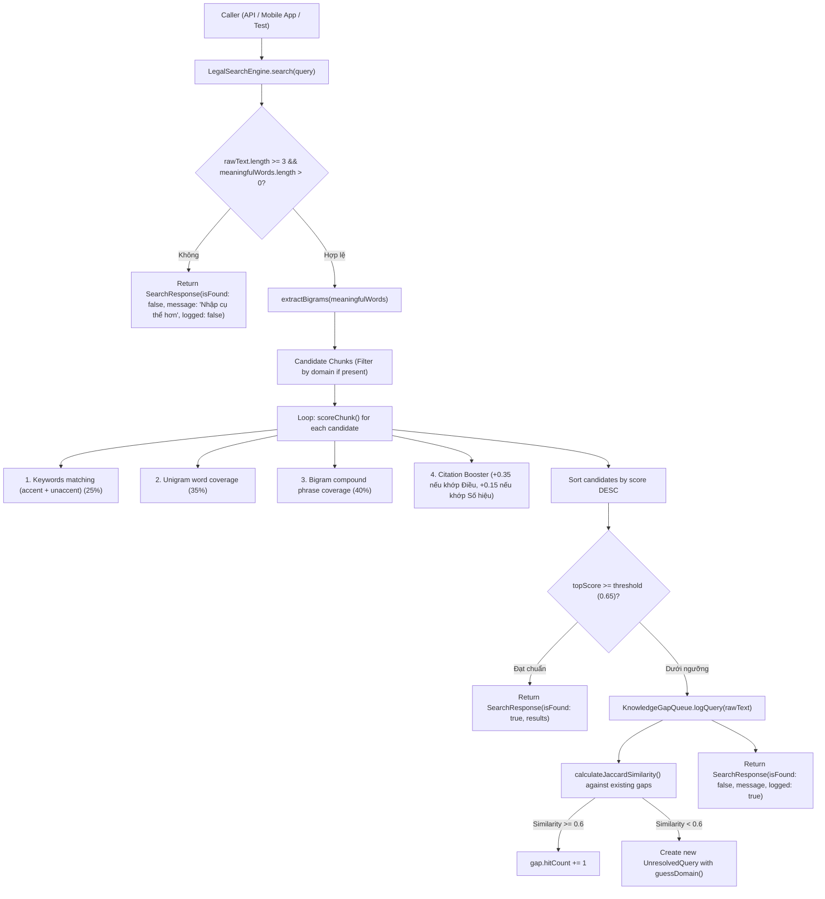

# Bước 2 & Bước 3: Kế Hoạch Kỹ Thuật — 002: Legal Search & Fallback Guard

---

# PHẦN A: BƯỚC 2 — KIẾN TRÚC (SYSTEM ARCHITECTURE)

## 1. Hợp đồng giữa các Component (Component Contracts)

```mermaid
flowchart LR
    subgraph UI ["Client Layer (Mobile App / Web Admin)"]
        ClientApp["Mobile/Web Client"]
        AdminDashboard["Web Admin Dashboard"]
    end

    subgraph SearchSubsystem ["Search & Retrieval Subsystem"]
        Validator["InputValidationGuard"]
        Engine["LegalSearchEngine\n(Compound Bigram + Unigram + Citation Booster)"]
        Guard["ConfidenceGuard (Threshold 0.65)"]
        GapQueue["KnowledgeGapQueue"]
    end

    subgraph StorageSubsystem ["Storage & Repository Layer"]
        ChunksRepo[("Legal Chunks Repository\n(4.501 Chunks JSON / DB)")]
        GapsDB[("Unresolved Queries Store\n(Knowledge Gaps)")]
    end

    ClientApp -->|SearchQuery| Validator
    Validator -- "Query rỗng / vô nghĩa" -->|Prompt for valid input| ClientApp
    Validator -- "Query hợp lệ" --> Engine
    Engine -->|Fetch Chunks| ChunksRepo
    Engine -->|Calculate Score| Guard
    Guard -- "Score >= 0.65" -->|SearchResponse (isFound: true)| ClientApp
    Guard -- "Score < 0.65" -->|Log Unresolved| GapQueue
    GapQueue -->|Save & Increment Hit| GapsDB
    Guard -- "Score < 0.65" -->|SearchResponse (isFound: false)| ClientApp
    AdminDashboard <-->|resolveGap / ignoreGap / getStats| GapQueue
```

### Hợp đồng giao tiếp (Contracts):
* **`ClientApp -> Engine`:** Gửi `SearchQuery { text, domain?, limit?, confidenceThreshold? }`.
* **`Engine -> ClientApp`:** Trả về `SearchResponse { isFound, topScore, results, message, loggedToKnowledgeGap }`.
* **`AdminDashboard <-> GapQueue`:** Quản trị viên duyệt câu hỏi đã nạp luật (`resolveGap`), loại bỏ câu spam (`ignoreGap`) và đọc báo cáo thống kê (`getStats`).

---

## 2. Mô hình Dữ liệu (Data Models)

### Bảng Cơ sở dữ liệu: `unresolved_queries` (Knowledge Gaps)
```sql
CREATE TABLE IF NOT EXISTS unresolved_queries (
    id UUID PRIMARY KEY DEFAULT gen_random_uuid(),
    query_text TEXT NOT NULL,
    normalized_query TEXT NOT NULL,
    domain_guess VARCHAR(30) DEFAULT 'OTHER', -- 'TRAFFIC' | 'LABOR' | 'SOCIAL_INSURANCE' | 'HOUSING' | 'OTHER'
    hit_count INT DEFAULT 1,
    status VARCHAR(20) DEFAULT 'unreviewed', -- 'unreviewed' | 'resolved' | 'ignored'
    admin_notes TEXT,                        -- Ghi chú của chuyên viên (VD: "Đã nạp thêm Luật Đất đai 2024")
    created_at TIMESTAMPTZ DEFAULT NOW(),
    updated_at TIMESTAMPTZ DEFAULT NOW()
);

CREATE INDEX IF NOT EXISTS idx_unresolved_queries_hit ON unresolved_queries (hit_count DESC);
CREATE INDEX IF NOT EXISTS idx_unresolved_queries_status ON unresolved_queries (status);
```

---

## 3. Ràng buộc & Ranh giới Bất biến (Invariants & Fallback Boundaries)

* **Ràng buộc bất biến 1 (No Self-Generated Law):** Không bao giờ cho phép AI tự suy diễn mức phạt hoặc điều luật để lưu vào `legal_chunks`. Dữ liệu luật chỉ được nạp từ file có mộc đỏ hoặc admin phê duyệt.
* **Ràng buộc bất biến 2 (Confidence Threshold Invariant):** Ngưỡng tin cậy $T = 0.65$. Nếu $\max(Score) < T$, kết quả trả về bắt buộc phải có `isFound = false` và `results = []`.
* **Ràng buộc bất biến 3 (Garbage Input Rejection):** Không bao giờ ghi nhận câu hỏi rỗng, chỉ có dấu câu hoặc < 3 ký tự vào `KnowledgeGapQueue`.
* **Ranh giới sự cố (Fallback Boundary):** Khi kho dữ liệu không có câu trả lời, hệ thống không được ném Exception hay sập app, mà phải trả về phản hồi lịch sự, an toàn và ghi nhận log phục vụ nâng cấp.

---

# PHẦN B: BƯỚC 3 — PROGRAM DESIGN (THIẾT KẾ CHI TIẾT MÃ NGUỒN)

## 1. Kiểu dữ liệu & Interfaces: `src/search/types.ts`
```typescript
export interface SearchQuery {
  text: string;
  domain?: LegalDomain;
  limit?: number;
  confidenceThreshold?: number; // Mặc định 0.65
}

export interface SearchResultItem {
  chunk: LegalChunk;
  score: number; // 0.0 - 1.0
}

export interface SearchResponse {
  isFound: boolean;
  topScore: number;
  results: SearchResultItem[];
  message: string;
  loggedToKnowledgeGap: boolean;
}

export type ExtendedDomain = LegalDomain | 'OTHER';
export type GapStatus = 'unreviewed' | 'resolved' | 'ignored';

export interface UnresolvedQuery {
  id: string;
  queryText: string;
  normalizedQuery: string;
  domainGuess: ExtendedDomain;
  hitCount: number;
  status: GapStatus;
  createdAt: string;
  updatedAt: string;
  adminNotes?: string;
}

export interface GapQueueStats {
  total: number;
  unreviewed: number;
  resolved: number;
  ignored: number;
}
```

---

## 2. Danh mục Hàm & Chữ ký (Signatures)

### Trong `src/search/engine.ts`:
* `class LegalSearchEngine`:
  - `constructor(chunks: LegalChunk[], gapQueue?: KnowledgeGapQueue)`
  - `search(query: SearchQuery): SearchResponse`
    - **Xử lý:** Input validation -> Trích xuất từ đơn + Bigrams -> Chấm điểm candidates -> Kiểm tra ngưỡng tin cậy.
  - `private scoreChunk(queryWords: string[], queryBigrams: string[], queryText: string, chunk: LegalChunk): number`
    - Tính điểm kết hợp: Từ khóa (25%) + Từ đơn (35%) + Cụm từ ghép Bigrams (40%) + Citation Booster (lên tới +0.5).

### Trong `src/search/gap-queue.ts`:
* `function removeVietnameseDiacritics(str: string): string`: Chuẩn hóa tiếng Việt không dấu chuẩn ECMAScript.
* `class KnowledgeGapQueue`:
  - `logQuery(rawQuery: string): UnresolvedQuery | null`: Ghi nhận câu hỏi thiếu (bỏ qua query rác).
  - `resolveGap(id: string, adminNotes?: string): boolean`: Đánh dấu đã giải quyết.
  - `ignoreGap(id: string, reason?: string): boolean`: Bỏ qua câu hỏi spam.
  - `getStats(): GapQueueStats`: Báo cáo thống kê hàng đợi.
  - `searchGaps(keyword: string): UnresolvedQuery[]`: Tra cứu trong hàng đợi.

---

## 3. Sơ đồ Luồng Gọi Hàm (Call Graph)


