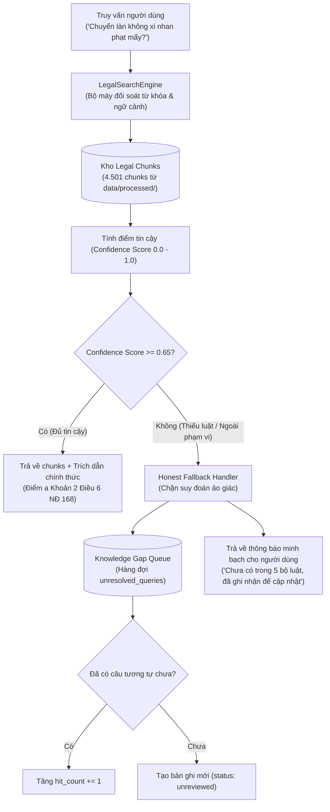

# Kế Hoạch Kỹ Thuật (Plan): 002 - Hybrid Search, Fallback Guard & Knowledge Gap Queue

## 1. Kiến Trúc Hệ Thống (Architecture)



---

## 2. Mô Hình Dữ Liệu (Data Models)

### `src/search/types.ts`

```typescript
import { LegalChunk, LegalDomain } from '../ingestion/types';

export interface SearchQuery {
  text: string;
  domain?: LegalDomain;
  limit?: number;
  confidenceThreshold?: number; // Mặc định 0.65
}

export interface SearchResultItem {
  chunk: LegalChunk;
  score: number; // 0.0 - 1.0
}

export interface SearchResponse {
  isFound: boolean;
  topScore: number;
  results: SearchResultItem[];
  message: string;
  loggedToKnowledgeGap: boolean;
}

export type GapStatus = 'unreviewed' | 'resolved' | 'ignored';

export interface UnresolvedQuery {
  id: string;
  queryText: string;
  normalizedQuery: string;
  domainGuess: LegalDomain | 'other';
  hitCount: number;
  status: GapStatus;
  createdAt: string;
  updatedAt: string;
}
```

---

## 3. Thuật Toán Xử Lý

### A. Bộ Máy Tìm Kiếm Từ Khóa & Ngữ Cảnh (Lexical + Keyword Scorer)
1. Chuẩn hóa câu hỏi: bỏ dấu câu, chuyển chữ thường (`tiền phạt`, `xe ô tô`, `chuyển làn`).
2. Khớp từ khóa chủ thể và mức phạt với danh mục `keywords` trong từng chunk.
3. Chấm điểm kết hợp:
   - Điểm khớp từ khóa chuyên ngành (`keywords`): Trọng số 50%.
   - Điểm bao phủ từ tố (token overlap / Jaccard): Trọng số 50%.
   - Điểm tổng hợp được chuẩn hóa về thang `[0.0, 1.0]`.

### B. Bộ Chặn Ảo Giác (Confidence Guard)
* Nếu `topScore < confidenceThreshold` (0.65):
  - Kích hoạt `KnowledgeGapQueue.logQuery()`.
  - Không trả về chunk nào gây nhiễu, thông báo rõ ràng cho người dùng.

### C. Khử Trùng Lặp Trong Knowledge Gap Queue (De-duplication)
* Chuẩn hóa văn bản bằng cách lọc stop-words tiếng Việt cơ bản.
* So sánh độ tương tự Jaccard của bộ từ vựng (`bag-of-words`).
* Nếu độ tương tự giữa câu mới và câu đã có >= 0.7: coi là cùng một nhu cầu tra cứu và tăng `hitCount`.
