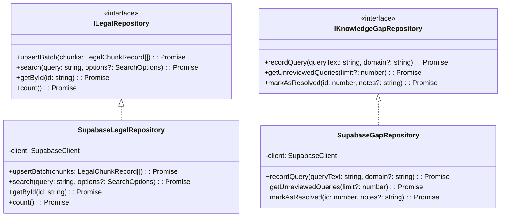
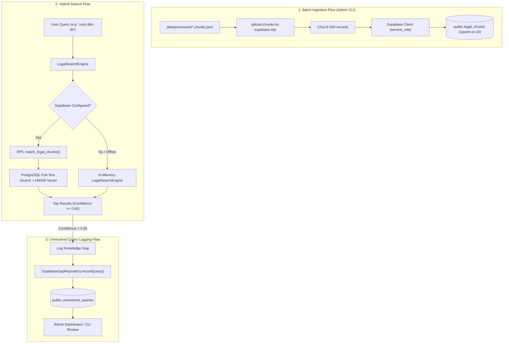

# PLAN-003: Supabase Storage Architecture & Program Design

## BƯỚC 2: KIẾN TRÚC HỆ THỐNG (System Architecture)

### 2.1. Hợp đồng giữa các Component (Component Contracts)
Để đảm bảo nguyên tắc Ponytail (đơn giản, dễ bảo trì, không ràng buộc cứng vào một giải pháp công nghệ) và kiểm thử offline tin cậy, tầng lưu trữ được thiết kế theo Repository Pattern:



### 2.2. Mô hình Dữ liệu (Data Model)
Chi tiết định nghĩa trong `specs/003-supabase-storage/schema.sql`:

1. **`public.legal_chunks`**:
   - `id TEXT PRIMARY KEY`: Khóa chính định danh theo cấu trúc điều luật (ví dụ: `168_2024_ND-CP_Điều_6_Khoản_2_Điểm_a`).
   - `doc_number TEXT NOT NULL`: Số hiệu văn bản quy phạm pháp luật.
   - `domain TEXT NOT NULL`: Lĩnh vực pháp lý (`TRAFFIC`, `LABOR`, `SOCIAL_INSURANCE`, `HOUSING`, `OTHER`).
   - `chapter`, `article`, `clause`, `point`: Thứ bậc cấu trúc điều luật.
   - `full_reference TEXT NOT NULL`: Trích dẫn đầy đủ phục vụ hiển thị nguồn gốc minh bạch.
   - `content TEXT NOT NULL`: Nội dung trích xuất giữ nguyên vẹn 3 tầng ngữ cảnh.
   - `keywords TEXT[]`: Mảng nhãn mức phạt và đối tượng phương tiện.
   - `search_vector TSVECTOR GENERATED ALWAYS AS (...) STORED`: Cột FTS tự sinh, đánh chỉ mục GIN.
   - `embedding VECTOR(768)`: Vector 768 chiều (Gemini Text Embedding), đánh chỉ mục HNSW cosine.
   - `created_at`, `updated_at`: Dấu vết thời gian (`timestamptz`).

2. **`public.unresolved_queries`**:
   - `id BIGINT GENERATED ALWAYS AS IDENTITY PRIMARY KEY`: Khóa tự tăng tuần tự 64-bit, chống phân mảnh B-tree index.
   - `query_text TEXT NOT NULL`: Nguyên văn câu hỏi của công dân.
   - `normalized_query TEXT NOT NULL`: Chuỗi đã chuẩn hóa (bỏ dấu tiếng Việt, chữ thường) để chống trùng lặp.
   - `domain_guess TEXT NOT NULL`: Dự đoán lĩnh vực pháp luật.
   - `hit_count INT DEFAULT 1`: Đếm số lần câu hỏi này được người dùng lặp lại.
   - `status TEXT DEFAULT 'unreviewed'`: Trạng thái (`unreviewed`, `resolved`, `ignored`).
   - `admin_notes TEXT`: Ghi chú bổ sung của Quản trị viên.

3. **`public.system_configs`**:
   - `key TEXT PRIMARY KEY`: Khóa định danh tham số (ví dụ: `search_weights`, `confidence_threshold`).
   - `value JSONB NOT NULL`: Dữ liệu cấu hình linh hoạt.
   - `description TEXT`: Diễn giải ý nghĩa tham số.

### 2.3. Ràng buộc & Ranh giới Bất biến (Invariants & Red Lines)
1. **Bảo mật RLS (Row Level Security):**
   - Client công cộng (`anon` / `authenticated`) chỉ có quyền `SELECT` trên `legal_chunks` và `system_configs`.
   - Client công cộng chỉ có quyền `INSERT` vào `unresolved_queries` khi độ dài chuỗi `>= 3` ký tự.
   - Chỉ `service_role` (hoặc Quản trị viên đã đăng nhập) mới có quyền ghi/sửa/xóa bảng `legal_chunks` và duyệt `unresolved_queries`.
2. **Khả năng Chịu lỗi Mạng (Resilience Boundary):**
   - Sử dụng batching 500 bản ghi/lô khi đẩy dữ liệu vào `legal_chunks`. Nếu 1 batch gặp lỗi, ghi log chi tiết và có thể thử lại mà không gây dừng tiến trình.
   - Có cơ chế kiểm tra biến môi trường: nếu thiếu `SUPABASE_URL` hoặc `SUPABASE_SERVICE_ROLE_KEY`, ứng dụng báo lỗi rõ ràng kèm hướng dẫn cài đặt thay vì crash đột ngột.

---

## BƯỚC 3: PROGRAM DESIGN (Thiết kế Chi tiết Mã nguồn)

### 3.1. Types & Interfaces (`src/storage/types.ts`)
```typescript
export interface LegalChunkRecord {
  id: string;
  doc_number: string;
  domain: string;
  chapter?: string | null;
  article: string;
  clause?: string | null;
  point?: string | null;
  full_reference: string;
  content: string;
  keywords?: string[];
  embedding?: number[] | null;
  created_at?: string;
  updated_at?: string;
}

export interface UnresolvedQueryRecord {
  id: number;
  query_text: string;
  normalized_query: string;
  domain_guess: string;
  hit_count: number;
  status: 'unreviewed' | 'resolved' | 'ignored';
  admin_notes?: string | null;
  created_at?: string;
  updated_at?: string;
}

export interface SearchOptions {
  limit?: number;
  domain?: string;
  embedding?: number[];
}
```

### 3.2. Signatures & Function Specifications
1. **`getSupabaseClient(useServiceRole?: boolean): SupabaseClient`**
   - Đọc biến môi trường `SUPABASE_URL`, `SUPABASE_ANON_KEY`, `SUPABASE_SERVICE_ROLE_KEY`.
   - Trả về Supabase Client singleton.
2. **`uploadChunksBatch(client: SupabaseClient, chunks: LegalChunkRecord[], batchSize?: number): Promise<UploadResult>`**
   - Chia 4.715 chunks thành các batch (mặc định 500).
   - Thực hiện `upsert` trên bảng `legal_chunks` với tùy chọn `{ onConflict: 'id' }`.
   - Trả về tổng số bản ghi đã chèn thành công và thời gian thực thi.
3. **`searchLegalChunksRpc(client: SupabaseClient, query: string, options?: SearchOptions): Promise<LegalChunkRecord[]>`**
   - Gọi hàm lưu trữ PostgreSQL `match_legal_chunks` qua RPC.

### 3.3. Call Graph (Sơ đồ Luồng Gọi Hàm)


