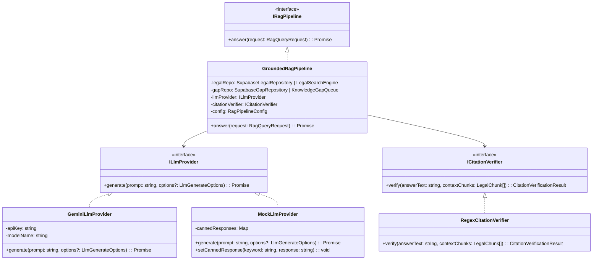
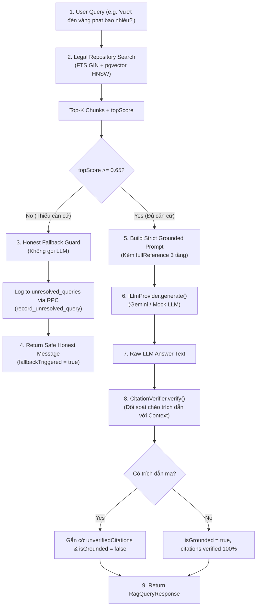

# PLAN-004: Grounded Legal RAG Pipeline Architecture & Program Design

## BƯỚC 2: KIẾN TRÚC HỆ THỐNG (System Architecture)

### 2.1. Hợp đồng giữa các Component (Component Contracts)
Hệ thống RAG Pháp lý được thiết kế theo nguyên lý tách rời trách nhiệm (Separation of Concerns) và tuân thủ Thang 7 bậc Ponytail:



### 2.2. Mô hình Dữ liệu (Data Model & DTOs)

1. **`RagQueryRequest`:**
   - `query: string`: Câu hỏi của người dùng.
   - `domain?: string`: Bộ lọc lĩnh vực pháp lý (tùy chọn).
   - `topK?: number`: Số lượng chunks tối đa nạp vào ngữ cảnh (mặc định: 5).
   - `confidenceThreshold?: number`: Ngưỡng tin cậy tối thiểu để kích hoạt LLM (mặc định: 0.65).

2. **`RagQueryResponse`:**
   - `answer: string`: Nội dung trả lời hoàn chỉnh.
   - `isGrounded: boolean`: Cờ xác nhận câu trả lời được dẫn chứng đầy đủ từ nguồn luật.
   - `confidenceScore: number`: Điểm số tin cậy của ngữ cảnh.
   - `citations: GroundedCitation[]`: Danh sách các trích dẫn pháp lý được sử dụng.
   - `verifiedSources: LegalChunk[]`: Các điều luật gốc làm căn cứ.
   - `fallbackTriggered: boolean`: Đánh dấu nếu câu hỏi bị từ chối do thiếu căn cứ.
   - `unverifiedCitations?: string[]`: Danh sách trích dẫn nghi ngờ ảo giác (nếu có).

3. **`GroundedCitation`:**
   - `fullReference: string`: Trích dẫn đầy đủ (VD: `Điểm đ Khoản 3 Điều 6 Nghị định 168/2024/NĐ-CP`).
   - `article: string`: Điều.
   - `clause?: string`: Khoản.
   - `point?: string`: Điểm.
   - `docNumber: string`: Số hiệu văn bản.
   - `isVerified: boolean`: Trạng thái đối soát với context chunks.

### 2.3. Ràng buộc & Ranh giới Bất biến (Invariants & Red Lines)
1. **Ranh giới Chống Ảo giác (Anti-Hallucination Red Line):**
   - Nếu `topScore < confidenceThreshold`: **TUYỆT ĐỐI CẤM GỌI LLM**. Phải trả lời bằng mẫu từ chối trung thực và kích hoạt ghi nhận khoảng trống tri thức vào `unresolved_queries`.
2. **Ranh giới Đối soát Trích dẫn (Citation Verification Invariant):**
   - Mọi trích dẫn trong câu trả lời sinh ra phải được đối chiếu với tập hợp các văn bản quy phạm pháp luật trong context chunks. Nếu phát hiện trích dẫn sai lệch hoàn toàn so với context, hệ thống gắn cờ cảnh báo `isGrounded = false`.
3. **Chính sách Chống Hardcode (Anti-Hardcode Policy):**
   - Mọi mẫu prompt (System Prompt, User Prompt template), ngưỡng tin cậy, thông điệp từ chối đều nằm trong đối tượng `DEFAULT_RAG_CONFIG` có thể tùy biến linh hoạt.

---

## BƯỚC 3: PROGRAM DESIGN (Thiết kế Chi tiết Mã nguồn)

### 3.1. Types & Interfaces (`src/rag/types.ts`)
```typescript
import { LegalChunk } from '../ingestion/types.js';

export interface GroundedCitation {
  fullReference: string;
  article: string;
  clause?: string;
  point?: string;
  docNumber: string;
  isVerified: boolean;
}

export interface RagQueryRequest {
  query: string;
  domain?: string;
  topK?: number;
  confidenceThreshold?: number;
}

export interface RagQueryResponse {
  answer: string;
  isGrounded: boolean;
  confidenceScore: number;
  citations: GroundedCitation[];
  verifiedSources: LegalChunk[];
  fallbackTriggered: boolean;
  unverifiedCitations?: string[];
}

export interface CitationVerificationResult {
  isValid: boolean;
  verifiedCitations: GroundedCitation[];
  unverifiedCitations: string[];
}

export interface LlmGenerateOptions {
  temperature?: number;
  maxOutputTokens?: number;
  systemInstruction?: string;
}

export interface LlmGenerateResult {
  text: string;
  tokensUsed?: number;
}

export interface RagPipelineConfig {
  defaultTopK: number;                  // Mặc định: 5
  defaultConfidenceThreshold: number;   // Mặc định: 0.65
  maxContextLengthChars: number;        // Mặc định: 8000
  systemPrompt: string;
  fallbackMessage: string;
}
```

### 3.2. Signatures & Function Specifications

1. **`buildGroundedPrompt(query: string, chunks: LegalChunk[], systemPrompt?: string): string`**
   - Ghép nối câu hỏi người dùng và nội dung các chunks kèm `fullReference` thành prompt tối ưu cho LLM.
2. **`verifyCitations(answerText: string, contextChunks: LegalChunk[]): CitationVerificationResult`**
   - Quét regex các mẫu trích dẫn pháp lý trong `answerText` (Điều... Khoản... Nghị định/Luật...).
   - Đối chiếu với `contextChunks.map(c => c.fullReference)`.
3. **`GroundedRagPipeline.answer(request: RagQueryRequest): Promise<RagQueryResponse>`**
   - Quản trị toàn bộ luồng RAG theo sơ đồ Call Graph dưới đây.

### 3.3. Call Graph (Sơ đồ Luồng Gọi Hàm)


