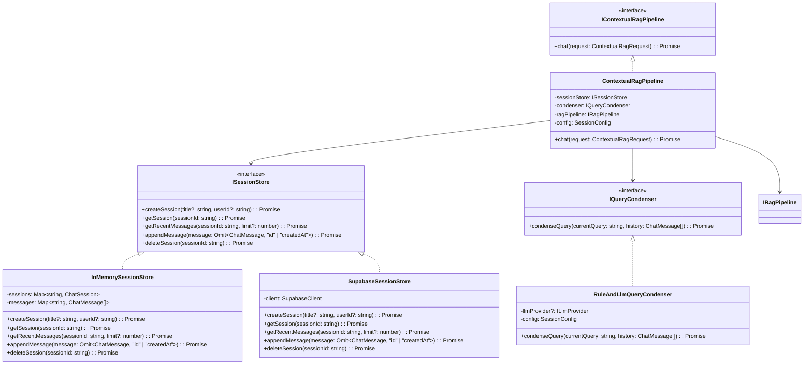
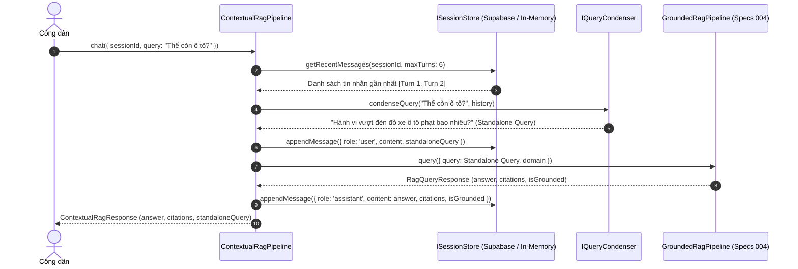

# PLAN-005: Multi-turn Legal Dialogue & Chat Session Memory

## BƯỚC 2: KIẾN TRÚC HỆ THỐNG (System Architecture)

### 2.1. Hợp đồng giữa các Component (Component Contracts)

Hệ thống quản lý phiên và bộ nhớ hội thoại được thiết kế theo nguyên lý tách rời trách nhiệm (Separation of Concerns):



---

### 2.2. Cơ sở Dữ liệu Supabase Schema (`specs/005-chat-session-memory/schema.sql`)

```sql
-- 1. Bảng lưu trữ phiên trò chuyện
CREATE TABLE IF NOT EXISTS public.chat_sessions (
    id UUID PRIMARY KEY DEFAULT gen_random_uuid(),
    user_id UUID REFERENCES auth.users(id) ON DELETE CASCADE NULL,
    title TEXT NOT NULL DEFAULT 'Phiên tư vấn pháp luật',
    created_at TIMESTAMPTZ NOT NULL DEFAULT timezone('utc', now()),
    updated_at TIMESTAMPTZ NOT NULL DEFAULT timezone('utc', now())
);

-- 2. Bảng lưu trữ từng tin nhắn trong phiên
CREATE TABLE IF NOT EXISTS public.chat_messages (
    id UUID PRIMARY KEY DEFAULT gen_random_uuid(),
    session_id UUID NOT NULL REFERENCES public.chat_sessions(id) ON DELETE CASCADE,
    role TEXT NOT NULL CHECK (role IN ('user', 'assistant', 'system')),
    content TEXT NOT NULL,
    standalone_query TEXT NULL,
    citations JSONB NOT NULL DEFAULT '[]'::jsonb,
    is_grounded BOOLEAN NOT NULL DEFAULT true,
    created_at TIMESTAMPTZ NOT NULL DEFAULT timezone('utc', now())
);

-- 3. Chỉ mục tối ưu hóa tốc độ truy vấn theo phiên và thời gian
CREATE INDEX IF NOT EXISTS idx_chat_messages_session_created 
    ON public.chat_messages(session_id, created_at ASC);

CREATE INDEX IF NOT EXISTS idx_chat_sessions_user 
    ON public.chat_sessions(user_id);

-- 4. Kích hoạt Row Level Security (RLS)
ALTER TABLE public.chat_sessions ENABLE ROW LEVEL SECURITY;
ALTER TABLE public.chat_messages ENABLE ROW LEVEL SECURITY;

-- 5. Chính sách RLS cho phép truy cập theo session_id hoặc user_id
CREATE POLICY "Allow public session access by ID" 
    ON public.chat_sessions FOR ALL USING (true);

CREATE POLICY "Allow public message access by session_id" 
    ON public.chat_messages FOR ALL USING (true);
```

---

### 2.3. Ràng Buộc & Ranh Giới Bất Biến (Invariants & Red Lines)

1. **Ranh giới Tính Độc lập của RAG Core:**
   - `GroundedRagPipeline` từ `specs/004` không bị thay đổi logic cốt lõi. Nó vẫn nhận vào một câu truy vấn độc lập và trả về kết quả có kiểm chứng.
   - Nhiệm vụ của `IQueryCondenser` là "chuẩn hóa" câu hỏi phụ thuộc thành câu hỏi độc lập trước khi gửi vào RAG Core.
2. **Ranh giới Cửa sổ Ngữ cảnh (Token Budget Invariant):**
   - Chỉ nạp tối đa `maxHistoryTurns` (mặc định: 6 tin nhắn gần nhất) vào prompt condensation để không gây tràn token và lãng phí chi phí gọi LLM.
3. **Chính sách Chống Hardcode (Anti-Hardcode):**
   - Mọi cấu hình (`maxHistoryTurns`, `sessionTimeoutMs`, `defaultTitle`, prompt templates) đều nằm trong đối tượng `DEFAULT_SESSION_CONFIG` có thể tùy biến linh hoạt.
4. **Cô lập Dữ liệu Kiểm thử:**
   - Unit test chạy offline 100% thông qua `InMemorySessionStore` và `MockLlmProvider`.

---

## BƯỚC 3: PROGRAM DESIGN (Thiết kế Chi tiết Mã nguồn)

### 3.1. Luồng Gọi Hàm (Sequence Diagram)



### 3.2. Cấu Trúc DTOs & Interfaces (`src/session/types.ts`)

```typescript
import { GroundedCitation, RagQueryResponse } from '../rag/types.js';

export type MessageRole = 'user' | 'assistant' | 'system';

export interface ChatMessage {
  id: string;
  sessionId: string;
  role: MessageRole;
  content: string;
  standaloneQuery?: string;
  citations?: GroundedCitation[];
  isGrounded?: boolean;
  createdAt: string;
}

export interface ChatSession {
  id: string;
  userId?: string;
  title: string;
  createdAt: string;
  updatedAt: string;
}

export interface ContextualRagRequest {
  sessionId: string;
  query: string;
  domain?: string;
  confidenceThreshold?: number;
}

export interface ContextualRagResponse extends RagQueryResponse {
  sessionId: string;
  standaloneQuery: string;
  isCondensed: boolean;
}

export interface SessionConfig {
  maxHistoryTurns: number;             // Mặc định: 6 (3 lượt hỏi - đáp)
  defaultSessionTitle: string;         // 'Phiên tư vấn pháp luật'
  condensationPromptTemplate: string;
}
```
