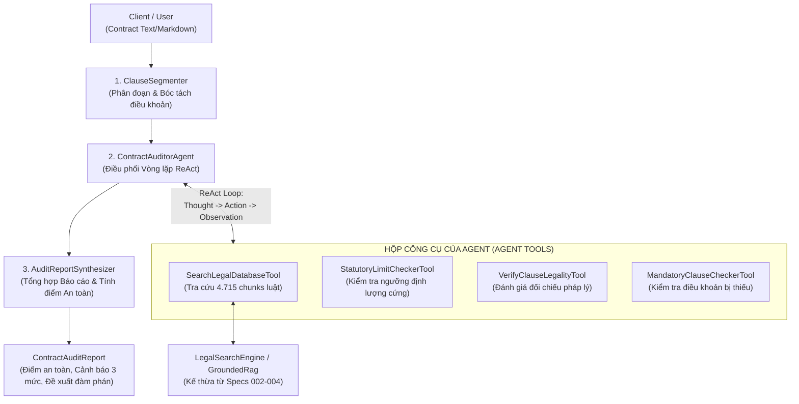
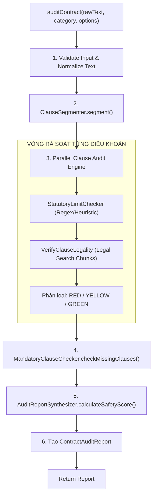

# BƯỚC 2 & BƯỚC 3: KẾ HOẠCH KỸ THUẬT — CONTRACT AUDITOR AGENT

---

# PHẦN A: BƯỚC 2 — KIẾN TRÚC (SYSTEM ARCHITECTURE)

## 1. Hợp đồng giữa các Component (Component Contracts)

Hệ thống Agentic Rà soát Hợp đồng được phân tách theo mô hình kiến trúc module độc lập, áp dụng triết lý Ponytail (tối giản, dễ kiểm thử offline, tái sử dụng các engine đã hoàn thành ở Giai đoạn 1):



### Các Thành phần Cốt lõi & Giao thức Truyền tin:
1. **`ClauseSegmenter` (Tầng Bóc tách Điều khoản):**
   * *Giao thức:* Pure Function / In-Memory Parser.
   * *Input:* Chuỗi văn bản thô của hợp đồng (`rawText`) và loại hợp đồng tùy chọn (`category`).
   * *Output:* Danh sách các đối tượng điều khoản có cấu trúc `ContractClause[]` kèm nhãn phân loại (Lương, Thử việc, Đặt cọc, Chấm dứt...).
2. **`ContractAuditorAgent` (Tầng Điều phối Agentic):**
   * *Giao thức:* Vòng lặp ReAct (Reasoning + Action) hướng đối tượng.
   * *Input:* Danh sách điều khoản `ContractClause[]` và cấu hình `ContractAuditorConfig`.
   * *Output:* Danh sách phát hiện rủi ro `ClauseAuditFinding[]` và danh sách thiếu sót `MissingClauseFinding[]`.
3. **`AuditReportSynthesizer` (Tầng Tổng hợp Báo cáo & Điểm số):**
   * *Giao thức:* In-Memory Aggregator.
   * *Nhiệm vụ:* Tính toán Điểm an toàn pháp lý (`SafetyScore: 0 - 100`), phân loại rủi ro tổng thể (`SAFE`, `CAUTION`, `HIGH_RISK`), và định dạng báo cáo.

---

## 2. Mô hình Dữ liệu Nghiệp vụ (Data Models & DTOs)

### Phân loại Hợp đồng & Mức độ Rủi ro
* **`ContractCategory`:**
  * `'labor'`: Hợp đồng lao động, thử việc, học nghề.
  * `'rental'`: Hợp đồng thuê nhà, phòng trọ, mặt bằng sinh hoạt.
  * `'civil_loan'`: Hợp đồng vay nợ, mượn tài sản cá nhân.
  * `'general_civil'`: Hợp đồng dịch vụ hoặc giao dịch dân sự thông thường.
* **`RiskLevel`:**
  * `RED_ILLEGAL`: Trái quy định pháp luật cấm, có dấu hiệu vô hiệu toàn phần/từng phần.
  * `YELLOW_WARNING`: Điều khoản bất lợi, mất cân bằng lợi ích nghiêm trọng, cần đàm phán lại.
  * `GREEN_SAFE`: Phù hợp luật pháp và thông lệ an toàn.

### Cấu trúc Báo cáo Thẩm định Hợp đồng (`ContractAuditReport`)
```typescript
export interface ContractAuditReport {
  documentTitle: string;
  category: ContractCategory;
  safetyScore: number; // Thang điểm 0 - 100
  riskTier: 'SAFE' | 'CAUTION' | 'HIGH_RISK';
  summary: string;
  stats: {
    totalClauses: number;
    redCount: number;
    yellowCount: number;
    greenCount: number;
    missingMandatoryCount: number;
  };
  findings: ClauseAuditFinding[];
  missingClauses: MissingClauseFinding[];
  auditedAt: string; // ISO 8601
}
```

---

## 3. Ràng buộc & Ranh giới Bất biến (Invariants, Red Lines & Anti-Hardcode)

### Ràng buộc An toàn Hệ thống (Invariants):
1. **Giới hạn Thang điểm An toàn (Safety Score Bound):**
   $$\text{SafetyScore} = \max\left(0, \min\left(100, 100 - (\text{redCount} \times P_{\text{red}} + \text{yellowCount} \times P_{\text{yellow}} + \text{missingCount} \times P_{\text{missing}})\right)\right)$$
   Điểm số luôn nằm nghiêm ngặt trong khoảng $[0, 100]$.
2. **Chặn Vòng lặp Vô tận (ReAct Loop Max Steps Guard):**
   * Số lượt lặp suy luận - hành động tối đa bị chặn bởi `config.maxSteps` (mặc định: 6 bước).
   * Không bao giờ để Agent lặp vô hạn khi gặp điều khoản phức tạp.
3. **Cơ chế Fallback An toàn (Resilience Fallback Boundary):**
   * Nếu mô hình LLM bị lỗi kết nối, quá tải 503, hoặc hết quota 429:
   * Hệ thống tự động kích hoạt **Rule-based Statutory Fallback**:
     - Dùng bộ quy tắc Heuristic và Regex kiểm tra các vi phạm phổ biến (giữ bằng cấp gốc, thử việc $> 60$ ngày, lãi suất $> 20\%$, đơn phương tịch thu cọc) để đảm bảo **luôn trả về báo cáo phân tích cho người dùng**, không bao giờ làm sập ứng dụng.

### Chính sách Không Hardcode (Anti-Hardcode Boundaries):
* **Tuyệt đối cấm:** Fix cứng trọng số trừ điểm (`25, 10, 15`), giới hạn bước lặp (`6`), model name, ngưỡng vi phạm trong thân hàm nghiệp vụ.
* **Giải pháp:** Toàn bộ được định nghĩa trong `ContractAuditorConfig` kèm đối tượng mặc định chuẩn mực `DEFAULT_CONTRACT_AUDITOR_CONFIG`.

---

# PHẦN B: BƯỚC 3 — PROGRAM DESIGN (THIẾT KẾ CHI TIẾT MÃ NGUỒN)

## 1. Kiểu Dữ liệu & Interfaces (Types)

```typescript
export type ContractCategory = 'labor' | 'rental' | 'civil_loan' | 'general_civil';

export type RiskLevel = 'RED_ILLEGAL' | 'YELLOW_WARNING' | 'GREEN_SAFE';

export interface ContractClause {
  id: string; // Ví dụ: "dieu-1", "dieu-2"
  title: string; // Ví dụ: "Điều 1: Công việc và địa điểm"
  text: string; // Toàn văn điều khoản
  category?: string; // Nhóm nghiệp vụ: "SALARY", "PROBATION", "DEPOSIT"...
  orderIndex: number;
}

export interface ClauseAuditFinding {
  clauseId: string;
  clauseTitle: string;
  clauseText: string;
  riskLevel: RiskLevel;
  reason: string;
  statutoryViolations: string[]; // Danh sách trích dẫn: "Khoản 1 Điều 17 Bộ luật Lao động 2019"
  renegotiationWording?: string; // Đề xuất văn bản sửa đổi gửi đối phương
}

export interface MissingClauseFinding {
  clauseType: string;
  description: string;
  statutoryReference: string; // Ví dụ: "Điểm f Khoản 1 Điều 21 BLLĐ 2019"
  importance: 'MANDATORY' | 'RECOMMENDED';
}

/**
 * Hợp đồng Agent Tool chuẩn
 */
export interface IAgentTool {
  readonly name: string;
  readonly description: string;
  execute(params: Record<string, any>): Promise<Record<string, any>>;
}

/**
 * Cấu hình Agent kiểm tra hợp đồng - Tránh hoàn toàn hardcode
 */
export interface ContractAuditorConfig {
  readonly redPenalty?: number;
  readonly yellowPenalty?: number;
  readonly missingPenalty?: number;
  readonly maxSteps?: number;
  readonly safeScoreThreshold?: number;
  readonly cautionScoreThreshold?: number;
}

export const DEFAULT_CONTRACT_AUDITOR_CONFIG: Required<ContractAuditorConfig> = {
  redPenalty: 25,
  yellowPenalty: 10,
  missingPenalty: 15,
  maxSteps: 6,
  safeScoreThreshold: 80,
  cautionScoreThreshold: 60,
};
```

---

## 2. Danh mục Lớp & Chữ ký Hàm (Signatures)

### A. Bộ Phân đoạn Hợp đồng: `ClauseSegmenter`
* `static segment(rawText: string, category?: ContractCategory): ContractClause[]`
  - Nhận diện các tiêu đề `Điều 1`, `Điều 2`, `Mục I`, phân tách văn bản thành từng khối điều khoản độc lập.

### B. Hộp Công cụ Nghiệp vụ: `StatutoryLimitCheckerTool`
* `checkLaborProbation(days: number, jobLevel?: string): LimitCheckResult`
  - Kiểm tra xem thời gian thử việc có vượt quá 60 ngày (hoặc 180 ngày đối với chức danh quản lý) theo Điều 25 BLLĐ 2019 hay không.
* `checkCivilLoanInterest(interestPercentPerYear: number): LimitCheckResult`
  - Kiểm tra trần lãi suất 20%/năm theo Điều 468 Bộ luật Dân sự 2015.
* `checkAdvanceNotice(days: number, contractType: string): LimitCheckResult`
  - Kiểm tra thời gian báo trước tối thiểu khi đơn phương chấm dứt hợp đồng.

### C. Công cụ Kiểm tra Điều khoản Bắt buộc: `MandatoryClauseChecker`
* `checkMissingClauses(clauses: ContractClause[], category: ContractCategory): MissingClauseFinding[]`
  - Đối chiếu danh mục điều khoản hiện có với các điều khoản bắt buộc phải có theo Điều 21 BLLĐ 2019 hoặc Điều 163 Luật Nhà ở 2023.

### D. Bộ Điều phối Agent: `ContractAuditorAgent`
* `auditContract(rawText: string, category?: ContractCategory, options?: ContractAuditorConfig): Promise<ContractAuditReport>`
  - Thực thi toàn bộ chu trình thẩm định: Phân đoạn $\rightarrow$ Rà soát điều khoản vi phạm $\rightarrow$ Rà soát điều khoản bất lợi $\rightarrow$ Kiểm tra điều khoản thiếu $\rightarrow$ Tính điểm an toàn $\rightarrow$ Xuất báo cáo tổng hợp.

---

## 3. Sơ đồ Luồng Gọi Hàm (Call Graph)


