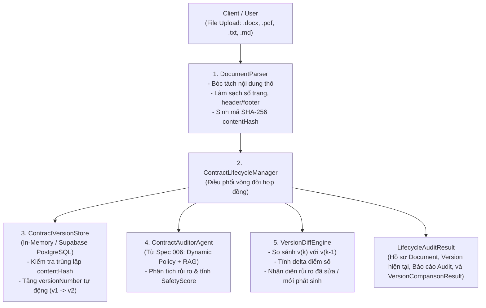
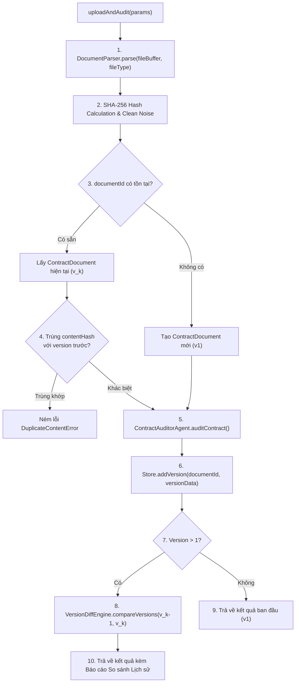

# BƯỚC 2 & BƯỚC 3: KẾ HOẠCH KỸ THUẬT — BỘ BÓC TÁCH TÀI LIỆU, QUẢN LÝ PHIÊN BẢN & SO SÁNH LỊCH SỬ THẨM ĐỊNH HỢP ĐỒNG

---

# PHẦN A: BƯỚC 2 — KIẾN TRÚC (SYSTEM ARCHITECTURE)

## 1. Hợp đồng giữa các Component (Component Contracts)

Hệ thống được thiết kế theo mô hình phân tầng lỏng (Loose Coupling), phân định rõ ràng giữa tầng Tiếp nhận tài liệu (Parser), tầng Lưu trữ phiên bản (Versioning Store), tầng Thẩm định (Auditor Agent) và tầng So sánh khác biệt (Diff Engine):



### Các Thành phần Cốt lõi & Giao thức Truyền tin:
1. **`DocumentParser` (Tầng Bóc tách & Chuẩn hóa Tài liệu):**
   * *Giao thức:* Pure Function / Adapter Pattern.
   * *Input:* `fileBuffer: Buffer | string`, `fileType: string` (`txt`, `md`, `docx`, `pdf`).
   * *Output:* `ParsedDocumentResult` (`rawText`, `cleanedText`, `contentHash`, `pageCount`).
2. **`ContractVersionStore` (Tầng Quản lý Phiên bản):**
   * *Giao thức:* Interface `IContractVersionStore`.
   * *Triển khai:*
     - `InMemoryContractVersionStore`: Chạy local phục vụ unit tests siêu tốc, offline.
     - `SupabaseContractVersionStore`: Lưu trữ bền vững trên các bảng `public.contract_documents` và `public.contract_versions`.
   * *Chức năng:* Lưu trữ hồ sơ hợp đồng, kiểm tra mã băm SHA-256 chống trùng lặp, cấp số phiên bản tăng dần ($1, 2, 3...$).
3. **`VersionDiffEngine` (Tầng So sánh Lịch sử Thẩm định):**
   * *Giao thức:* Pure In-Memory Diffing Engine.
   * *Input:* Phiên bản trước ($v_{k-1}$) và Phiên bản hiện tại ($v_k$).
   * *Output:* `VersionComparisonResult` (`scoreDelta`, `resolvedViolations`, `newViolations`, `status`).
4. **`ContractLifecycleManager` (Tầng Điều phối Cấp cao):**
   * *Nhiệm vụ:* Tiếp nhận file tải lên $\rightarrow$ Bóc tách $\rightarrow$ Kiểm tra trùng lặp $\rightarrow$ Thẩm định bằng `ContractAuditorAgent` $\rightarrow$ Lưu version $\rightarrow$ So sánh với version trước $\rightarrow$ Trả về kết quả tổng hợp trọn gói cho client.

---

## 2. Mô hình Dữ liệu Nghiệp vụ (Data Models & DTOs)

### A. Hồ sơ Hợp đồng (`ContractDocument`)
```typescript
export interface ContractDocument {
  id: string; // UUID
  title: string; // Tiêu đề hợp đồng
  category: ContractCategory; // 'labor' | 'rental' | 'civil_loan' | 'general_civil'
  currentVersion: number; // Phiên bản hiện tại (1, 2, 3...)
  createdAt: string; // ISO 8601
  updatedAt: string; // ISO 8601
}
```

### B. Phiên bản Hợp đồng (`ContractVersion`)
```typescript
export interface ContractVersion {
  id: string; // UUID
  documentId: string; // Khóa ngoại tham chiếu ContractDocument.id
  versionNumber: number; // 1, 2, 3...
  fileName: string; // Tên file gốc (VD: HDLD_v1.docx)
  fileType: string; // 'docx' | 'pdf' | 'txt' | 'md'
  contentHash: string; // SHA-256 hash của cleanedText
  cleanedText: string; // Nội dung văn bản sạch
  auditReport: ContractAuditReport; // Báo cáo thẩm định từ Spec 006
  createdAt: string; // ISO 8601
}
```

### C. Kết quả So sánh Phiên bản (`VersionComparisonResult`)
```typescript
export type ComparisonStatus = 'IMPROVED' | 'REGRESSED' | 'UNCHANGED';

export interface VersionComparisonResult {
  previousVersion: number;
  currentVersion: number;
  scoreDelta: number; // Điểm thay đổi: currScore - prevScore
  resolvedViolations: ClauseAuditFinding[]; // Rủi ro ở bản trước đã được sửa
  newViolations: ClauseAuditFinding[]; // Rủi ro mới phát sinh trong bản này
  status: ComparisonStatus;
  summary: string;
}
```

---

## 3. Ràng buộc & Ranh giới Bất biến (Invariants & Anti-Hardcode)

### Ràng buộc Bất biến (Invariants):
1. **Tính Tăng đơn điệu của Phiên bản (Monotonic Version Numbering):**
   * Mọi phiên bản mới của một hợp đồng luôn có $v_k = v_{k-1} + 1$. Tuyệt đối không cho phép nhảy cóc hoặc trùng số phiên bản.
2. **Chặn Tải lên Trùng lặp (Duplicate Content Guard):**
   * Trong cùng một `documentId`, không bao giờ được phép tạo version mới nếu mã băm SHA-256 (`contentHash`) của nội dung sạch trùng khớp với phiên bản liền kề.
3. **Biến thiên Điểm số Có Ranh giới (Score Delta Invariant):**
   * $\text{scoreDelta} = \text{Score}_{\text{current}} - \text{Score}_{\text{previous}} \in [-100, 100]$.
4. **Phân tách Ranh giới Bảo mật (RLS & Object Grants):**
   * Mọi truy vấn Supabase liên quan đến `contract_documents` và `contract_versions` đều tuân thủ chính sách RLS và hỗ trợ xác thực client an toàn.

---

# PHẦN B: BƯỚC 3 — PROGRAM DESIGN (THIẾT KẾ CHI TIẾT MÃ NGUỒN)

## 1. Kiểu Dữ liệu & Interfaces (Types)

```typescript
export interface ParsedDocumentResult {
  rawText: string;
  cleanedText: string;
  contentHash: string; // SHA-256 hex string
  pageCount?: number;
}

export interface IDocumentParser {
  parse(input: Buffer | string, fileType: string): Promise<ParsedDocumentResult>;
}

export interface CreateVersionDto {
  fileName: string;
  fileType: string;
  contentHash: string;
  cleanedText: string;
  auditReport: ContractAuditReport;
}

export interface IContractVersionStore {
  createDocument(title: string, category: ContractCategory): Promise<ContractDocument>;
  getDocument(documentId: string): Promise<ContractDocument | null>;
  addVersion(documentId: string, versionData: CreateVersionDto): Promise<ContractVersion>;
  getVersion(documentId: string, versionNumber: number): Promise<ContractVersion | null>;
  listVersions(documentId: string): Promise<ContractVersion[]>;
}

export interface LifecycleUploadParams {
  documentId?: string; // Nếu không truyền sẽ tạo document mới (Version 1)
  title?: string;
  category?: ContractCategory;
  fileBuffer: Buffer | string;
  fileName: string;
  fileType: string;
}

export interface LifecycleAuditResult {
  document: ContractDocument;
  version: ContractVersion;
  comparison?: VersionComparisonResult; // Có khi versionNumber > 1
}
```

---

## 2. Sơ đồ Luồng Gọi Hàm (Call Graph)


