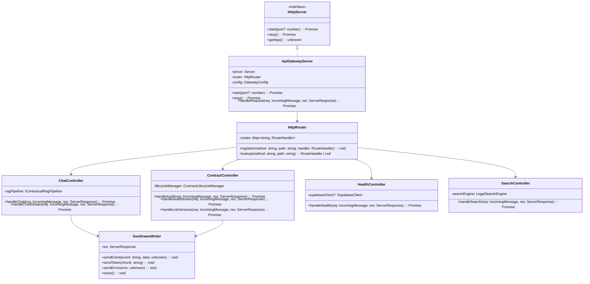
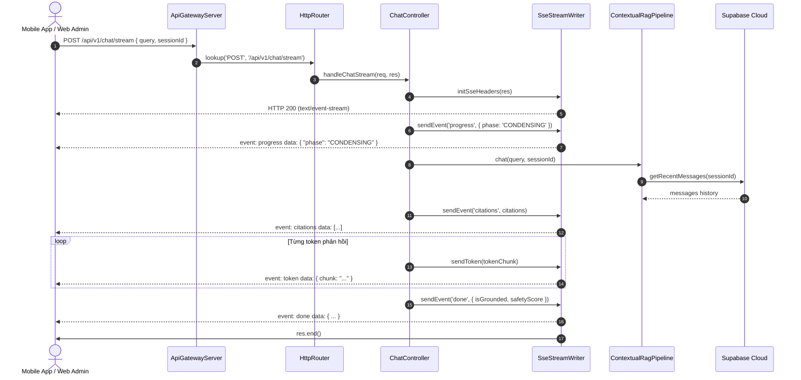

# BƯỚC 2 & BƯỚC 3: KẾ HOẠCH KỸ THUẬT — CỔNG TRUY CẬP TRUNG TÂM & STREAMING (CENTRAL API GATEWAY)

---

# PHẦN A: BƯỚC 2 — KIẾN TRÚC HỆ THỐNG (SYSTEM ARCHITECTURE)

## 1. Hợp đồng giữa các Component (Component Contracts)

Hệ thống được thiết kế theo mô hình phân tầng Modular Gateway, dựa hoàn toàn trên thư viện chuẩn `node:http` (Ponytail Rung 3 - Stdlib):



---

## 2. Giao thức Truyền tin & Định dạng Dữ liệu (DTOs & Protocols)

### 2.1. Cấu hình Cổng Truy Cập (`GatewayConfig`)
```typescript
export interface GatewayConfig {
  port: number; // Mặc định: 3000 (hoặc PORT từ .env)
  host: string; // Mặc định: '0.0.0.0'
  corsOrigins: string[]; // Mặc định: ['*'] hoặc các domain của Web Admin
  enableSse: boolean; // Cho phép streaming SSE
  requestTimeoutMs: number; // Mặc định: 30000 (30 giây)
}
```

### 2.2. DTOs Yêu cầu & Phản hồi (Request/Response DTOs)

1. **Hỏi đáp Pháp luật (`ChatRequestDto` & `ChatResponseDto`):**
```typescript
export interface ChatRequestDto {
  query: string;
  sessionId?: string;
  userId?: string;
  domain?: string;
}

export interface ChatResponseDto {
  sessionId: string;
  query: string;
  standaloneQuery?: string;
  answer: string;
  citations: CitationReferenceDto[];
  isGrounded: boolean;
  confidenceScore: number;
}
```

2. **Rà soát Hợp đồng (`ContractAuditRequestDto`):**
```typescript
export interface ContractAuditRequestDto {
  documentId?: string; // Bỏ trống nếu là bản thảo v1 mới
  title?: string;
  category: 'labor' | 'rental' | 'civil_loan' | 'general_civil';
  content: string; // Nội dung văn bản
  fileName?: string;
  fileType?: 'docx' | 'pdf' | 'txt' | 'md' | 'doc';
}
```

3. **Tra cứu Điều luật (`SearchRequestDto` & `SearchResponseDto`):**
```typescript
export interface SearchRequestDto {
  query: string;
  domain?: string;
  limit?: number;
}

export interface SearchResponseDto {
  query: string;
  results: SearchResultItemDto[];
  totalMatches: number;
}
```

---

## 3. Ràng buộc & Ranh giới Bất biến (Invariants & Anti-Hardcode)

1. **Zero Hardcoded Endpoints/Ports:**
   * Cổng lắng nghe nạp từ `process.env.PORT` với fallback mặc định rõ ràng `3000`.
   * Cấu hình CORS nạp từ `process.env.CORS_ORIGINS`.
2. **Chuẩn hóa Định dạng Lỗi (Standardized Error Envelope):**
   * Mọi ngoại lệ trả về đều tuân thủ cấu trúc đồng nhất:
     ```json
     {
       "success": false,
       "error": {
         "code": "DUPLICATE_CONTENT_ERROR",
         "message": "Nội dung tải lên trùng khớp với phiên bản trước đó",
         "statusCode": 409
       }
     }
     ```
3. **Cơ chế Ngắt Kết nối An toàn (Graceful Shutdown & Keep-Alive):**
   * Khi server nhận tín hiệu `SIGINT` hoặc `SIGTERM`, dừng nhận request mới và hoàn tất các stream đang dở dang trước khi đóng tiến trình.

---

# PHẦN B: BƯỚC 3 — PROGRAM DESIGN (THIẾT KẾ CHI TIẾT MÃ NGUỒN)

## 1. Sơ đồ Luồng Gọi Hàm (Sequence Diagram: Chat SSE Streaming)



## 2. Cấu trúc Mô-đun Dự kiến triển khai (`src/api/`)
```text
src/api/
├── types.ts                   # Interfaces, DTOs, RouteHandler signature, GatewayConfig
├── sse-writer.ts              # Helper chuyên biệt ghi luồng Server-Sent Events (SSE)
├── router.ts                  # Router HTTP tối giản (hỗ trợ GET, POST, OPTIONS, 404)
├── controllers/
│   ├── health-controller.ts   # Handler kiểm tra trạng thái sức khỏe (/api/v1/health)
│   ├── chat-controller.ts     # Handler hỏi đáp pháp luật (REST & SSE Stream)
│   ├── contract-controller.ts # Handler thẩm định & quản lý vòng đời hợp đồng
│   └── search-controller.ts   # Handler tra cứu nhanh điều luật
└── gateway-server.ts          # ApiGatewayServer khởi động và đóng gói node:http
```
