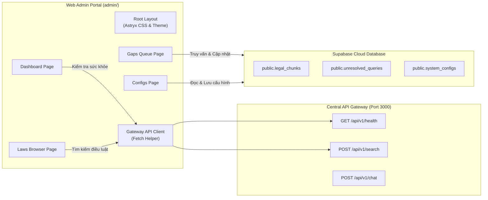

# BƯỚC 2 & BƯỚC 3: KẾ HOẠCH KỸ THUẬT — CỔNG QUẢN TRỊ DỮ LIỆU VỚI ASTRYX DESIGN SYSTEM (WEB ADMIN)

---

# PHẦN A: BƯỚC 2 — KIẾN TRÚC HỆ THỐNG (SYSTEM ARCHITECTURE)

## 1. Cấu Trúc Thư Mục Ứng Dụng (`admin/`)

Ứng dụng Web Admin được đặt độc lập trong thư mục `admin/` theo chuẩn Next.js 15 App Router:

```text
admin/
├── app/
│   ├── layout.tsx             # Root Layout (Nạp Astryx Reset, Astryx CSS & Theme Neutral)
│   ├── page.tsx               # Dashboard tổng quan (Trạng thái Gateway, Thống kê dữ liệu)
│   ├── laws/
│   │   └── page.tsx           # Tra cứu & Duyệt 4.715 chunks dữ liệu luật
│   ├── gaps/
│   │   └── page.tsx           # Quản lý hàng đợi câu hỏi công dân chưa có luật (unresolved_queries)
│   └── configs/
│       └── page.tsx           # Quản lý cấu hình hệ thống thời gian thực (system_configs)
├── components/
│   ├── AdminNavbar.tsx        # Thanh điều hướng trên cùng sử dụng Astryx Stack & Button
│   ├── StatusBadge.tsx        # Huy hiệu hiển thị trạng thái hệ thống
│   └── StatCard.tsx           # Thẻ hiển thị số liệu thống kê
├── lib/
│   └── api-client.ts          # Client gọi sang Central API Gateway (http://localhost:3000)
├── package.json               # Next.js 15, React 19, @astryxdesign/core, @astryxdesign/theme-neutral
├── tsconfig.json              # TypeScript config cho Next.js
└── next.config.mjs            # Cấu hình Next.js
```

---

## 2. Hợp Đồng Giữa Các Thành Phần & API Gateway



---

## 3. Ràng Buộc & Ranh Giới Bất Biến (Invariants & Anti-Hardcode)

1. **URL API Gateway Động:**
   - URL của Central API Gateway được nạp từ biến môi trường `NEXT_PUBLIC_API_GATEWAY_URL` với giá trị mặc định là `http://localhost:3000`. Tuyệt đối không hardcode IP máy cá nhân.
2. **Cơ Chế Client-Side Boundaries:**
   - Các components sử dụng hooks React (`useState`, `useEffect`) hoặc tương tác sự kiện (`onClick`) bắt buộc phải có `'use client'` ở dòng đầu tiên.
3. **Tuân Thủ Hệ Thống Design Tokens của Astryx:**
   - Mọi khoảng cách (gap, padding, margin) sử dụng các tokens chuẩn: `xs`, `sm`, `md`, `lg`, `xl`.
   - Màu sắc và độ phân cấp typography tuân thủ `Heading` và `Text` của `@astryxdesign/core`.

---

# PHẦN B: BƯỚC 3 — PROGRAM DESIGN (THIẾT KẾ CHI TIẾT)

## 1. Thành Phần Giao Diện Cốt Lõi (Astryx Component Tree)

* **Root Layout:**
  - Nhập `@astryxdesign/core/reset.css`, `@astryxdesign/core/astryx.css`, và `@astryxdesign/theme-neutral/theme.css`.
  - Bao bọc toàn bộ trang trong `Stack gap="md"`.
* **Thanh Điều Hướng (`AdminNavbar`):**
  - Sử dụng `Stack direction="row" justify="space-between"` để phân bố logo và các nút chuyển trang.
  - Sử dụng `Button variant="subtle"` hoặc `Button variant="primary"` theo trạng thái active route.
* **Thẻ Thống Kê (`StatCard`):**
  - Sử dụng `Card variant="outlined"` kết hợp `Heading level={2}` hiển thị con số và `Text color="secondary"` mô tả nhãn.

---

## 2. API Client Wrapper (`admin/lib/api-client.ts`)

```typescript
export const GATEWAY_URL = process.env.NEXT_PUBLIC_API_GATEWAY_URL || 'http://localhost:3000';

export async function fetchGatewayHealth() {
  const res = await fetch(`${GATEWAY_URL}/api/v1/health`);
  if (!res.ok) throw new Error(`Gateway Error: ${res.status}`);
  return res.json();
}

export async function searchLaws(query: string, domain?: string, limit = 10) {
  const res = await fetch(`${GATEWAY_URL}/api/v1/search`, {
    method: 'POST',
    headers: { 'Content-Type': 'application/json' },
    body: JSON.stringify({ query, domain, limit }),
  });
  if (!res.ok) throw new Error(`Search Error: ${res.status}`);
  return res.json();
}
```
