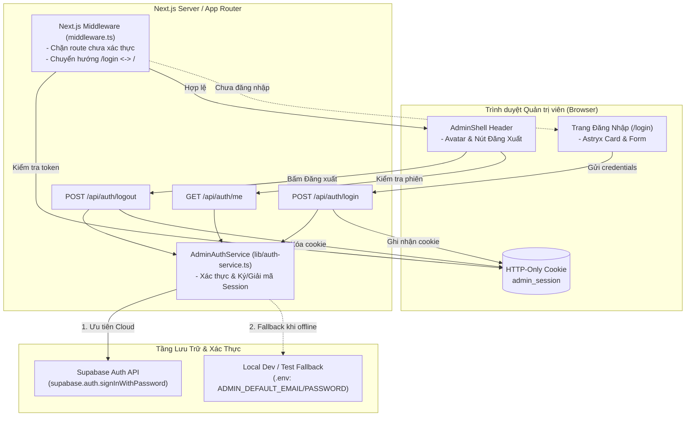
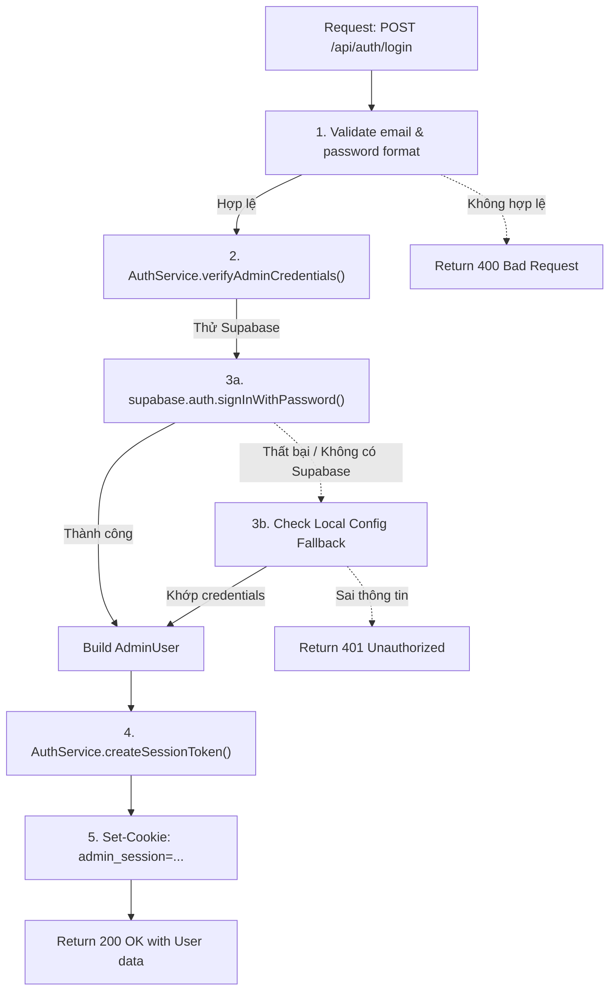

# BƯỚC 2 & BƯỚC 3: KẾ HOẠCH KỸ THUẬT — XÁC THỰC CỔNG QUẢN TRỊ (WEB ADMIN AUTHENTICATION)

---

# PHẦN A: BƯỚC 2 — KIẾN TRÚC (SYSTEM ARCHITECTURE)

## 1. Hợp đồng giữa các Component (Component Contracts)



### Chi tiết hợp đồng API:
1. `POST /api/auth/login`:
   - **Input:** `{ email: string, password: string }`
   - **Output Success (200):** `{ success: true, user: { id: string, email: string, role: string, fullName: string } }` kèm header `Set-Cookie: admin_session=...; Path=/; HttpOnly; SameSite=Lax`
   - **Output Error (401 / 400):** `{ success: false, error: string }`
2. `POST /api/auth/logout`:
   - **Input:** Rỗng
   - **Output Success (200):** `{ success: true }` kèm header xóa cookie `admin_session` (`Max-Age=0`)
3. `GET /api/auth/me`:
   - **Input:** Đọc từ cookie `admin_session`
   - **Output (200):** `{ authenticated: true, user: AdminUser }`
   - **Output (401):** `{ authenticated: false, error: 'Unauthorized' }`

---

## 2. Mô hình Dữ liệu (Data Models & Schemas)

### Cấu trúc Token & Session Payload:
```typescript
export interface AdminUser {
  id: string;
  email: string;
  role: 'superadmin' | 'curator' | 'admin';
  fullName: string;
  createdAt?: string;
}

export interface AdminSessionPayload {
  userId: string;
  email: string;
  role: 'superadmin' | 'curator' | 'admin';
  fullName: string;
  issuedAt: number;
  expiresAt: number;
}
```

### Cấu hình Quản trị (Anti-Hardcode Config Options):
```typescript
export interface AdminAuthConfig {
  readonly sessionCookieName: string;
  readonly sessionDurationSeconds: number;
  readonly secretKey: string;
  readonly defaultEmail?: string;
  readonly defaultPassword?: string;
}
```

---

## 3. Ràng buộc & Ranh giới Bất biến (Invariants & Anti-Hardcode)

* **Ràng buộc An toàn (Invariants):**
  - Cookie phiên **BẮT BUỘC** có cờ `HttpOnly: true` để chống tấn công XSS từ các script độc hại.
  - Thời hạn phiên (Session Expiration) mặc định là 7 ngày (`604,800` giây), có thể cấu hình linh hoạt.
  - Mật khẩu đầu vào bắt buộc được validate không được để trống (tối thiểu 6 ký tự).
* **Ranh giới Sự cố (Fallback Boundaries):**
  - Khi mất kết nối internet hoặc không có cấu hình Supabase Cloud (`SUPABASE_URL` thiếu), hệ thống kích hoạt chế độ **Local Secure Fallback** đối chiếu với thông tin quản trị cấu hình qua `.env`.
* **Chính sách Chống Hardcode (Anti-Hardcode Red Lines):**
  - Tuyệt đối không hardcode mật khẩu hay email của tài khoản admin trong mã nguồn `src/` hoặc `admin/`.
  - Mọi giá trị mặc định chỉ phục vụ test và được cô lập trong `DEFAULT_AUTH_CONFIG` kèm khả năng override 100% từ môi trường thực tế.

---

# PHẦN B: BƯỚC 3 — PROGRAM DESIGN (THIẾT KẾ CHI TIẾT MÃ NGUỒN)

## 1. Kiểu dữ liệu & Interfaces

```typescript
export interface LoginCredentials {
  email: string;
  password: string;
}

export interface AuthVerificationResult {
  success: boolean;
  user?: AdminUser;
  error?: string;
}

export const DEFAULT_AUTH_CONFIG: AdminAuthConfig = {
  sessionCookieName: 'admin_session',
  sessionDurationSeconds: 7 * 24 * 3600, // 7 days
  secretKey: process.env.ADMIN_SESSION_SECRET || 'civiclaw-admin-secret-key-salt-2026',
  defaultEmail: process.env.ADMIN_DEFAULT_EMAIL || 'admin@civiclaw.vn',
  defaultPassword: process.env.ADMIN_DEFAULT_PASSWORD || 'CivicLaw@2026',
};
```

## 2. Danh mục Hàm & Chữ ký (Signatures)

1. `verifyAdminCredentials(credentials: LoginCredentials, config?: AdminAuthConfig): Promise<AuthVerificationResult>`
   - Xác thực thông tin qua Supabase Auth nếu khả dụng, hoặc đối chiếu với cấu hình bảo mật.
2. `createSessionToken(user: AdminUser, config?: AdminAuthConfig): string`
   - Tạo chuỗi token mã hóa chứa thông tin phiên và chữ ký kiểm tra tính toàn vẹn (HMAC SHA-256 / Base64URL).
3. `verifySessionToken(token: string, config?: AdminAuthConfig): AdminSessionPayload | null`
   - Giải mã và xác thực chữ ký token, kiểm tra hạn sử dụng `expiresAt`.
4. `getCookieHeader(name: string, value: string, maxAge: number): string`
   - Định dạng header `Set-Cookie` chuẩn với các thuộc tính an toàn `HttpOnly; Path=/; SameSite=Lax`.

## 3. Sơ đồ Luồng Gọi Hàm (Call Graph)


