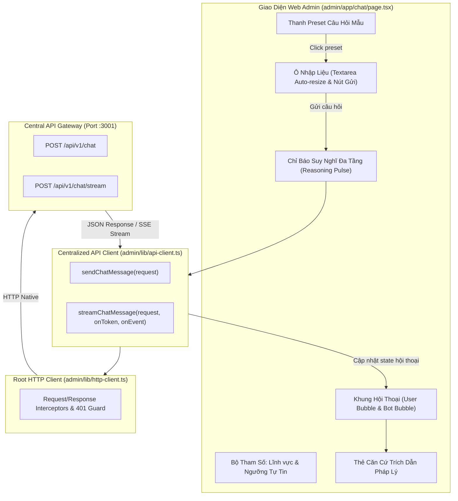

# Bước 2 & 3: Kiến Trúc & Thiết Kế Chi Tiết — Admin Chatbot Playground

---

## 1. Kiến Trúc Hệ Thống (System Architecture)



---

## 2. Mô Hình Dữ Liệu & Types (TypeScript Contracts)

### 2.1 Interface Tin Nhắn Trong Khung Chat (`ChatPlaygroundMessage`)
```typescript
export interface ChatCitation {
  docNumber?: string;
  article?: string;
  clause?: string;
  point?: string;
  fullReference: string;
  title?: string;
  isVerified?: boolean;
}

export interface ChatPlaygroundMessage {
  id: string;
  role: 'user' | 'assistant';
  content: string;
  timestamp: string;
  isThinking?: boolean;
  thinkingStep?: string; // Vd: "Đang phân tích ngữ cảnh...", "Đang đối soát 5 bộ luật..."
  standaloneQuery?: string;
  citations?: ChatCitation[];
  isGrounded?: boolean;
  confidenceScore?: number;
  error?: string;
}
```

### 2.2 Interface Tham Số Kiểm Thử (`ChatPlaygroundConfig`)
```typescript
export interface ChatPlaygroundConfig {
  domain?: string;              // 'all' | 'Giao thông' | 'Lao động' | 'BHXH' | 'Nhà ở' | 'Dân sự'
  confidenceThreshold: number;  // 0.60 - 0.95 (mặc định 0.85)
  enableStreaming: boolean;     // Bật/tắt chế độ stream token
}
```

### 2.3 Interface Request & Response Gateway
```typescript
export interface ChatApiRequest {
  query: string;
  sessionId?: string;
  domain?: string;
  confidenceThreshold?: number;
}

export interface ChatApiResponse {
  success: boolean;
  data: {
    sessionId: string;
    query: string;
    standaloneQuery?: string;
    answer: string;
    citations: ChatCitation[];
    isGrounded: boolean;
    confidenceScore: number;
    metadata?: Record<string, unknown>;
  };
  error?: {
    code: string;
    message: string;
  };
}
```

---

## 3. Thiết Kế Chi Tiết Hàm & Module (Program Design)

### 3.1 Mở rộng `admin/lib/api-client.ts`
```typescript
/**
 * Gửi câu hỏi chat tới Central API Gateway
 */
export async function sendChatMessage(request: ChatApiRequest): Promise<ChatApiResponse['data']>;

/**
 * Stream câu hỏi chat dạng SSE với callback token
 */
export async function streamChatMessage(
  request: ChatApiRequest,
  onToken: (token: string) => void,
  onProgress?: (step: string, message: string) => void,
  onCitations?: (citations: ChatCitation[]) => void
): Promise<ChatApiResponse['data']>;
```

### 3.2 Giao diện Trang `admin/app/chat/page.tsx`
- Bọc bởi `PageContainer` chuẩn Astryx, tiêu đề: `"Sân Thử Nghiệm Hỏi Đáp Pháp Lý AI (Chatbot Playground)"`.
- Thanh điều khiển trên cùng (Inspector Bar):
  * Domain selector (`Select` hoặc `TabList`).
  * Confidence threshold slider / input.
  * Nút "Tạo phiên mới" (`Button variant="secondary"`).
- Khung hội thoại trung tâm (Chat Viewport):
  * Chiều cao tự thích ứng (Flex fill), có thanh cuộn mượt `#1E293B`.
  * Hiệu ứng gõ chữ (Streaming typing animation) nếu gateway trả về hoặc mô phỏng.
  * Bong bóng suy nghĩ (Thinking Bubble) với biểu tượng AI `🧠` nhấp nháy đa màu.
- Khung nhập tin nhắn đáy (Bottom Chat Bar):
  * Textarea tự động co giãn 1-4 dòng.
  * Nút "Gửi" (`Button variant="primary"` với icon `➤`).
  * Gợi ý phím tắt `Enter để gửi, Shift+Enter xuống dòng`.

---

## 4. Ranh Giới Bất Biến & Chống Hardcode (Invariants & Red Lines)
1. **Anti-Hardcode:** Tuyệt đối không hardcode endpoint URL. Mọi kết nối đều đi qua hàm `getGatewayBaseUrl()` và `httpClient` đã được gắn interceptor.
2. **Khả Năng Chống Sập (Fault-Tolerance):** Nếu Gateway offline hoặc trả về lỗi 500/400, giao diện hiển thị thông báo lỗi bên trong khung chat, không được throw unhandled exception làm hỏng màn hình.
3. **Typography & Màu Sắc:** 100% font chữ `'Inter'`, font-variant-numeric `tabular-nums` cho độ tự tin và thời gian. Nền `#090D16`, Card `#131B2E`.
