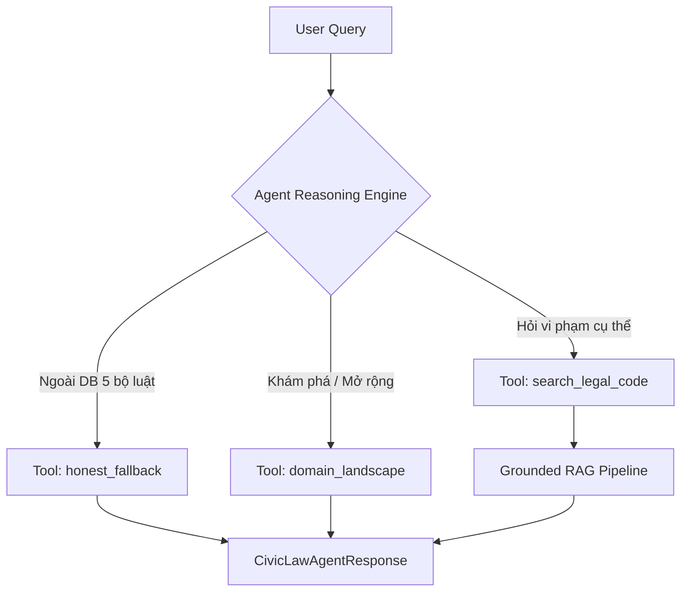

# Kế Hoạch Thiết Kế Kiến Trúc: CivicLaw Legal Agent

## 1. Kiến Trúc Hệ Thống (System Architecture)

## 2. Hợp Đồng Thành Phần (Component Contracts)

### Types & Interfaces (`src/agent/types.ts`)
- `LegalDomain`: 5 lĩnh vực (`TRAFFIC`, `LABOR`, `INSURANCE`, `HOUSING`, `CIVIL`).
- `AgentTool`: Định nghĩa công cụ (`name`, `description`, `execute`).
- `AgentDecision`: Quyết định suy luận ReAct (`thought`, `action`, `actionInput`, `confidence`, `domain`, `isExploratory`).
- `DomainLandscapeInfo`: Cấu trúc bản đồ toàn cảnh, tài liệu, trụ cột và chủ đề gợi ý tương tác.
- `CivicLawAgentOptions`: Cấu hình vòng lặp tối đa, ngưỡng tin cậy, bật/tắt landscape.
- `CivicLawAgentResponse`: Kế thừa `RagQueryResponse`, bổ sung `domain`, `guidedTopics`, `decision`, `thoughtTrace`.

### Domain Landscape Database (`src/agent/domain-landscape.ts`)
- `DOMAINS_LANDSCAPE_DATA`: Dữ liệu có cấu trúc của 5 bộ luật cốt lõi.
- `detectExploratoryDomain(query)`: Nhận diện câu hỏi broad.
- `isOutOfScopeDomain(query)`: Phát hiện câu hỏi ngoài DB.
- `formatLandscapeSynthesis(landscape)`: Sinh Markdown tổng quan bản đồ pháp luật.
- `formatHonestFallback(query, topic)`: Sinh Markdown thông báo phạm vi dữ liệu.

### Bounded ReAct Agent (`src/agent/civic-law-agent.ts`)
- Vòng lặp ReAct có chặn trên `maxIterations` (mặc định 3).
- Đăng ký 3 công cụ nội bộ: `domain_landscape`, `search_legal_code`, `honest_fallback`.
- Tương thích kép: Hỗ trợ cả `.process(request)` và alias `.query(request)` chuẩn `IRagPipeline`.
