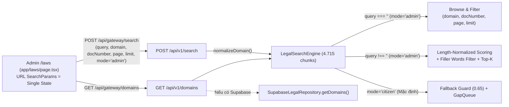

# Bước 2 & 3: Kế Hoạch Kỹ Thuật — 013: Unified Legal Search & Admin Laws Browser

## 1. Kiến trúc Tổng thể (Single Source of Truth)



---

## 2. Hợp Đồng Dữ Liệu & Program Design

### 2.1. Chuẩn hóa Domain tập trung (`src/storage/types.ts`)
- Bổ sung bảng ánh xạ chuẩn `DOMAIN_ALIASES` trong `normalizeDomain(domain: string)` (Ponytail Rung 2 Reuse — 1 hàm dùng chung cho Storage, Search, Controller):
  - `'traffic'`, `'TRAFFIC'`, `'giao thong'`, `'giao thông'`, `'giao thông đường bộ'` ➔ `'TRAFFIC'`
  - `'labor'`, `'LABOR'`, `'lao dong'`, `'lao động'`, `'tiền lương'` ➔ `'LABOR'`
  - `'social_insurance'`, `'SOCIAL_INSURANCE'`, `'insurance'`, `'INSURANCE'`, `'bhxh'`, `'bao hiem xa hoi'`, `'bảo hiểm xã hội'` ➔ `'SOCIAL_INSURANCE'`
  - `'housing'`, `'HOUSING'`, `'nha o'`, `'nhà ở'`, `'cư trú'` ➔ `'HOUSING'`
  - `'civil'`, `'CIVIL'`, `'dan su'`, `'dân sự'` ➔ `'CIVIL'`
  - `'land'`, `'LAND'`, `'dat dai'`, `'đất đai'` ➔ `'LAND'`
- Cho phép `normalizeDomain()` nhận giá trị không phân biệt hoa/thường/dấu tiếng Việt bằng `removeVietnameseDiacritics`.

### 2.2. Mở rộng `SearchQuery` & `SearchResponse` (`src/search/types.ts`)
```typescript
export type SearchMode = 'citizen' | 'admin';

export interface SearchQuery {
  text: string;
  domain?: LegalDomain | string;
  docNumber?: string;
  limit?: number;
  page?: number;              // 1-based pagination (mặc định 1)
  confidenceThreshold?: number;
  mode?: SearchMode;          // 'citizen' (mặc định, giữ Fallback Guard 0.65) | 'admin' (Browse + Dispute Top-K)
  skipGapLogging?: boolean;
}

export interface SearchResponse {
  isFound: boolean;
  topScore: number;
  results: SearchResultItem[];
  totalMatches?: number;      // Tổng số kết quả khớp trước khi cắt trang
  page?: number;
  limit?: number;
  searchMode?: 'browse' | 'search';
  message: string;
  loggedToKnowledgeGap: boolean;
}

export interface DomainDocumentSummary {
  docNumber: string;
  title?: string;
  chunkCount: number;
}

export interface DomainSummaryItem {
  code: string;
  name: string;
  description?: string;
  chunkCount: number;
  documents: DomainDocumentSummary[];
}
```

### 2.3. Cải tiến `LegalSearchEngine` (`src/search/engine.ts`)
1. **Lọc `domain` qua `normalizeDomain()`** & lọc `docNumber` (so sánh không phân biệt hoa thường/khoảng trắng thừa).
2. **Browse Mode (khi `rawText === ''` với `mode === 'admin'`):**
   - Lọc theo `domain` và `docNumber`, cắt lát theo `page` & `limit`, trả `totalMatches`, `isFound: results.length > 0`, `searchMode: 'browse'`, `loggedToKnowledgeGap: false`.
3. **Chấm điểm câu mô tả tranh chấp dài (`scoreChunk`):**
   - Lọc từ nối/đại từ tự nhiên (`DISPUTE_FILLER_WORDS`) khỏi `meaningfulWords` khi có đủ từ khóa chuyên môn (chỉ bỏ filler words phổ biến nếu phần còn lại >= 2 từ).
   - Chuẩn hóa mẫu số cho câu dài (`effectiveWordDenominator = Math.min(queryWords.length, 6)` khi `mode === 'admin'`, tương tự với bigrams: `Math.min(queryBigrams.length, 5)`) kết hợp so khớp trên cả `content` và `fullReference` cùng `citationArticleBonus`/`citationDocBonus`.
   - Khi `mode === 'admin'`: trả tất cả chunks có `score > 0` (không cắt bỏ bằng ngưỡng `0.65`), sắp xếp giảm dần theo `score`, phân trang theo `page` & `limit` (giới hạn tối đa `MAX_SEARCH_LIMIT = 100`), trả `totalMatches = scoredResults.length`, `loggedToKnowledgeGap: false`.
   - Khi `mode === 'citizen'` (mặc định): giữ nguyên ngưỡng `0.65` và `gapQueue.logQuery()` cho BDD Spec 002.
4. **Thống kê Metadata thực (`getDomainSummary()`):**
   - Duyệt `this.chunks` chuẩn hóa domain qua `normalizeDomain()`, gom nhóm `chunkCount` theo từng domain & `docNumber`.

### 2.4. Gateway Endpoints (`src/api/controllers/search-controller.ts` & `gateway-factory.ts`)
- `POST /api/v1/search`: Chấp nhận `{ query?, domain?, docNumber?, page?, limit?, mode? }`. Chỉ trả `400` nếu `mode !== 'admin'` và `query` rỗng; với `mode === 'admin'`, `query = ""` hợp lệ cho Browse Mode.
- `GET /api/v1/domains`: Kết hợp tên mô tả từ `SupabaseLegalRepository.getDomains()` (nếu online) với `searchEngine.getDomainSummary()` (số lượng chunks & văn bản thực tế) + mapping tên văn bản chuẩn.

### 2.5. Admin API Client & UI (`/laws`)
- `admin/lib/api-client.ts`:
  - `fetchLegalDomains()` gọi `GET /api/gateway/domains` (fallback an toàn theo đúng 4 domain thật khi offline, không chứa `100/2019/NĐ-CP` hay `Dân sự` rỗng).
  - `searchLaws(options | query, domain, limit)` sửa mapper đọc `docNumber`, `article`, `clause`, `point`, `fullReference`, `chapter`, `totalMatches`, `page`, `limit`. Nếu gặp `HttpError` từ server thì không trả mock giả mà trả `errorMessage` thật; nếu lỗi mạng offline thì gắn cờ `isOfflineFallback: true`.
- `admin/app/laws/page.tsx`:
  - URL `searchParams` (`q`, `domain`, `doc`, `page`) là nguồn trạng thái duy nhất (khử double-fetch).
  - Mặc định vào `/laws` không có `q` sẽ mở Browse Mode tải 20 điều luật thật đầu tiên.
  - 1 thanh `TabList` động theo `GET /api/gateway/domains` + 1 `Selector` lọc theo Văn bản (`docNumber`) cập nhật động theo Tab + nút `Xóa bộ lọc` + thanh phân trang `Trước / Sau`.
