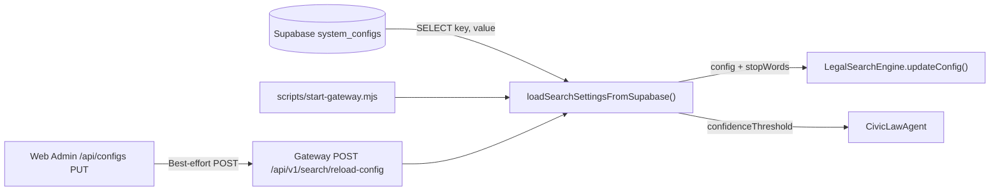

# Bước 2 & Bước 3: Kế hoạch Kỹ thuật — Auto-IDF & Dynamic System Configs

---

# PHẦN A: KIẾN TRÚC (SYSTEM ARCHITECTURE)

## 1. Hợp đồng giữa các Component (Component Contracts)

* **`loadSearchSettingsFromSupabase(supabase)`:**
  - **Input:** `SupabaseClient | undefined`
  - **Output:** `Promise<LoadedSearchSettings>` (`{ config: Partial<SearchEngineConfig>; stopWords?: Set<string>; loadedKeys: string[] }`)
  - **Contract:** Không bao giờ ném ngoại lệ khi DB lỗi hoặc JSON sai schema; chỉ nhận các trường hợp lệ tại trust boundary.
* **`POST /api/v1/search/reload-config` (`SearchController.handleReloadConfig`):**
  - **Input:** HTTP POST (không yêu cầu body).
  - **Output:** `{ success: true, data: { reloaded: boolean, loadedKeys: string[], config: SearchEngineConfig, stopWordsCount: number } }` (hoặc fallback note nếu chưa cấu hình Supabase).

## 2. Mô hình Dữ liệu (`public.system_configs` hiện có)
Các key chuẩn trên Supabase:
- `stop_words`: `string[]` (từ dừng có dấu tiếng Việt).
- `search_weights`: `{ keyword, unigram, bigram, citationArticleBonus, citationDocBonus }`.
- `confidence_threshold`: `number` trong `(0, 1]`.
- `min_query_length`: `number` nguyên `>= 1`.

## 3. Ràng buộc & Ranh giới Bất biến (Invariants, Red Lines & Anti-Hardcode)
- **Invariants:**
  - `score` trả về luôn nằm trong `[0.0, 1.0]`.
  - Mọi từ đơn không nằm trong kho luật (`df = 0`) có trọng số IDF trung tính `1.0` (không phình mẫu số cho query dài, nhưng vẫn giữ `wordCoverage = 0` khi mọi từ đều OOV).
  - Bắt buộc xóa hoàn toàn `DISPUTE_FILLER_WORDS` khỏi `src/search/engine.ts`.
- **Anti-Hardcode:**
  - URL Gateway khi gọi reload từ Web Admin đọc từ `process.env.GATEWAY_URL || process.env.NEXT_PUBLIC_API_GATEWAY_URL || process.env.NEXT_PUBLIC_GATEWAY_URL`, có fallback hằng số đặt tên rõ nghĩa (`DEFAULT_GATEWAY_URL`) cho phát triển local, kiểm tra `http:`/`https:`, và không bao giờ chứa secrets.

---

# PHẦN B: PROGRAM DESIGN (THIẾT KẾ CHI TIẾT MÃ NGUỒN)

## 1. Kiểu dữ liệu & Chữ ký
* Trong `src/search/types.ts`:
  - `LoadedSearchSettings`: `{ config: Partial<SearchEngineConfig>; stopWords?: Set<string>; loadedKeys: string[] }`
* Trong `src/search/config-loader.ts`:
  - `export async function loadSearchSettingsFromSupabase(supabase?: Pick<SupabaseClient, 'from'>): Promise<LoadedSearchSettings>`
* Trong `src/search/engine.ts`:
  - Hằng số `DEFAULT_OOV_WORD_WEIGHT = 1.0` (trọng số trung tính cho từ ngoài kho luật).
  - Private indexes trên `LegalSearchEngine`:
    - `private dfAccented = new Map<string, number>();`
    - `private dfUnaccented = new Map<string, number>();`
    - `private corpusBigrams = new Set<string>();`
    - `private rebuildIdfIndex(): void` (gọi tại `constructor` và `addChunks`)
    - `private getWordIdf(word: string): number`
  - Public methods:
    - `public updateConfig(customConfig?: Partial<SearchEngineConfig>, customStopWords?: Set<string>): void`
    - `public getStopWordsCount(): number`
    - `public getWordIdfScore(word: string): number` (phục vụ kiểm thử & quan sát trọng số IDF)
* Trong `src/api/controllers/search-controller.ts`:
  - `async handleReloadConfig(_req: IncomingMessage, res: ServerResponse): Promise<void>`

## 2. Cơ chế Auto-IDF & Chuẩn hóa điểm
1. Khi build index trên $N = \text{chunks.length}$:
   - Chuẩn hóa text của từng chunk bằng `normalizeQueryText(chunk.content + ' ' + chunk.fullReference)` (chỉ giữ token có độ dài `>= 2`).
   - Lưu `dfAccented`, `dfUnaccented` (theo tập duy nhất trên mỗi chunk) và `corpusBigrams` (tập cụm 2 từ có trong chunk, cả dạng có dấu và không dấu).
2. Khi tính điểm `scoreChunk`:
   - `wordIdf(w)`: nếu `df(w) === 0` trả `DEFAULT_OOV_WORD_WEIGHT (1.0)`, ngược lại $\ln\left(\frac{N + 1}{\text{df}(w) + 1}\right) + 1$.
   - `wordCoverage = totalWordIdf > 0 ? Math.min(1.0, matchedIdfSum / totalWordIdf) : 0`.
   - Với `bigramCoverage` ở `isAdminMode`: lọc các bigram có trong kho (`inCorpusBigrams`); nếu `inCorpusBigrams.length >= 2`, dùng `Math.min(inCorpusBigrams.length, 5)` làm mẫu số (ngược lại dùng `Math.min(queryBigrams.length, 5)`), giúp câu tranh chấp dài không bị chia điểm oan cho các cặp từ nối vô nghĩa.
