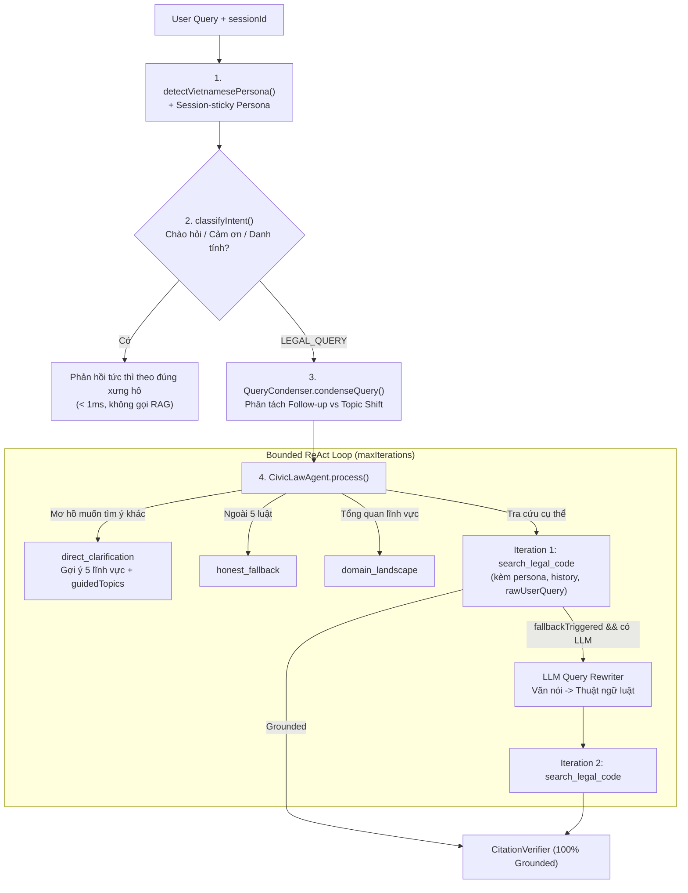

# Bước 2 & Bước 3: Kế hoạch Kỹ thuật — Conversational Agentic RAG (`015`)

---

# PHẦN A: KIẾN TRÚC (SYSTEM ARCHITECTURE)

## 1. Luồng Điều phối Hội thoại (Conversational Pipeline Flow)

## 2. Ràng buộc & Bất biến (Invariants & Red Lines)
- **Tương thích ngược (Zero Regression):**
  - `buildGroundedPrompt(query, chunks)` (không truyền context hội thoại) vẫn trả về `systemInstruction === DEFAULT_RAG_CONFIG.systemPrompt` chứa `'CivicLaw AI'` và `'100% CĂN CỨ VÀ TRÍCH DẪN'`.
  - `classifyIntent('Xin chào')` / `'chào bạn'` / `'Cảm ơn'` giữ nguyên `GREETING_RESPONSE` / `THANKS_RESPONSE` / `BOT_IDENTITY_RESPONSE`.
  - `CitationVerifier` không bao giờ bị bỏ qua dù văn phong tự nhiên hơn.
- **Anti-Hardcode:**
  - `DEFAULT_CONVERSATION_PERSONA`, `DEFAULT_QUERY_REWRITE_PROMPT`, giới hạn lượt lịch sử và `maxQueryRewriteRetries` đều khai báo qua hằng số/Options object rõ nghĩa, hỗ trợ nạp tùy chọn từ `system_configs` (`chat_persona`) nếu có.

---

# PHẦN B: PROGRAM DESIGN (THIẾT KẾ CHI TIẾT MÃ NGUỒN)

## 1. Module & Interfaces

### `src/session/persona.ts`
- `export interface ConversationPersona { assistantPronoun: string; userPronoun: string; detectedFromInput: boolean; }`
- `export const DEFAULT_CONVERSATION_PERSONA: ConversationPersona = { assistantPronoun: 'Mình', userPronoun: 'Bạn', detectedFromInput: false };`
- `export function detectVietnamesePersona(text: string, fallback?: Partial<ConversationPersona>): ConversationPersona`
- `export function resolveSessionPersona(currentQuery: string, history: Array<{ role: string; content: string }>, defaultPersona?: Partial<ConversationPersona>): ConversationPersona`
- `export function buildPersonaStyleInstruction(persona: ConversationPersona, history?: Array<{ role: string; content: string }>): string`

### `src/session/intent-router.ts`
- Mở rộng regex `GREETING_PATTERNS`, `THANKS_PATTERNS`, `IDENTITY_PATTERNS` nhận diện thêm cách xưng hô tự nhiên tiếng Việt (`em chào anh`, `anh ơi`, `chào em`, `cảm ơn anh nhiều`, `anh là ai`).
- `export function classifyIntent(queryText: string, defaultPersona?: Partial<ConversationPersona>): IntentRouteResult`
  - Nếu câu chào/cảm ơn có đại từ rõ ràng (`detectedFromInput === true`) -> sinh câu chào/cảm ơn tự nhiên theo đúng `persona`.
  - Nếu trung tính (`"Xin chào"`, `"chào bạn"`) -> trả về `GREETING_RESPONSE` / `THANKS_RESPONSE` / `BOT_IDENTITY_RESPONSE` chuẩn.

### `src/session/query-condenser.ts`
- Chuyển sang kiến trúc **Pure LLM-only** (loại bỏ hoàn toàn 6 mảng Regex hardcode và `isDependentQuery()`, tránh sai lệch không dấu/từ đồng âm như *"thôi"* vs *"thổi"*).
- Khi có `history.length > 0` và có `llmProvider`, `condenseQuery()` giao trực tiếp cho LLM dùng `DEFAULT_SESSION_CONFIG.condensationPromptTemplate` để phân biệt câu nối tiếp (ghép ngữ cảnh và trả `isCondensed: true`) vs chuyển ý mới / câu độc lập (trả nguyên câu hoặc giữ độc lập với `isCondensed: false`).
- Khi `history` rỗng, không có `llmProvider`, hoặc LLM lỗi/hết quota (`429`), trả về an toàn `{ standaloneQuery: trimmed, isCondensed: false }`.

### `src/agent/civic-law-agent.ts` & `src/agent/types.ts`
- `CivicLawAgentOptions`: thêm `enableQueryRewriteRetry?: boolean` (default: `true`), `queryRewritePromptTemplate?: string`.
- `CivicLawAgentRequest`: thêm optional `persona?: ConversationPersona`, `rawUserQuery?: string`, `history?: Array<{ role: string; content: string }>`.
- Tool `direct_clarification`: kích hoạt khi người dùng hỏi mở muốn chuyển sang ý khác mà chưa nêu cụ thể nội dung (VD: *"mình muốn tìm ý khác"*, *"cho em hỏi vấn đề khác"*) -> phản hồi thân thiện kèm 5 lĩnh vực chính.
- Trong `process()`: nếu Vòng 1 gọi `search_legal_code` trả `fallbackTriggered: true` và có `this.llmProvider` + `enableQueryRewriteRetry` -> gọi LLM chuyển câu nói đời thường sang từ khóa pháp luật (`rewriteQueryForLegalSearch`), rồi thực hiện Vòng 2 `search_legal_code` nếu câu viết lại khác đáng kể so với câu vòng 1.

### `src/rag/prompt-builder.ts` & `src/rag/pipeline.ts` & `src/session/pipeline.ts`
- `RagQueryRequest`: thêm optional `persona?: ConversationPersona`, `rawUserQuery?: string`, `history?: Array<{ role: string; content: string }>`.
- `DEFAULT_RAG_CONFIG.systemPrompt`: cập nhật hướng dẫn trả lời tự nhiên như ChatGPT (bỏ ép 3 đề mục cứng nhắc, giữ `'CivicLaw AI'` & `'100% CĂN CỨ VÀ TRÍCH DẪN'`).
- `buildGroundedPrompt(query, chunks, config, conversationalCtx?)`: khi có `conversationalCtx`, nối thêm `buildPersonaStyleInstruction(...)` vào `systemInstruction` và truyền câu hỏi gốc tự nhiên của người dùng bên cạnh câu truy vấn đã chuẩn hóa.
- `ContextualRagPipeline.chat()`: gọi `resolveSessionPersona(query, recentMessages)` -> truyền `persona` vào cả `classifyIntent` lẫn `agent.process(...)`.
