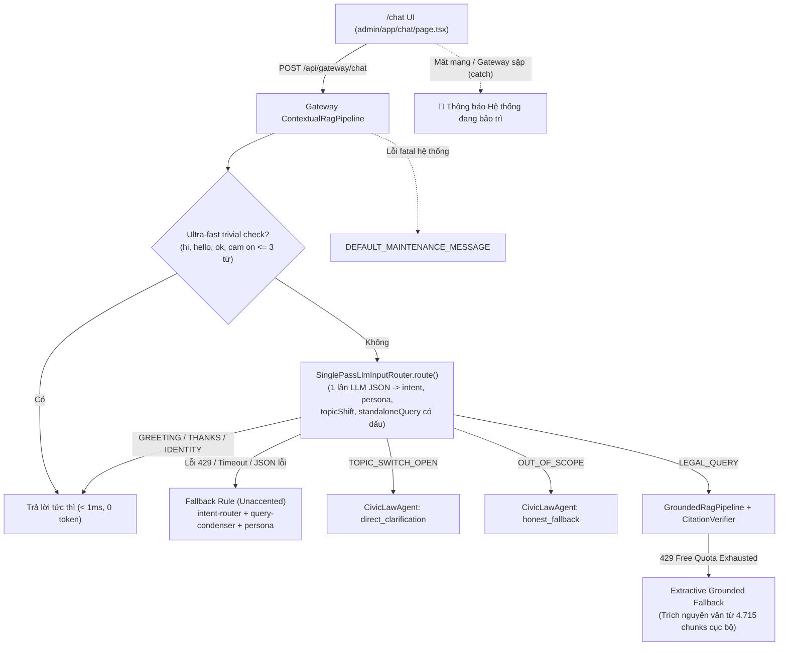

# Bước 2 & Bước 3: Kế hoạch Kỹ thuật — Single-Pass LLM Input Router & Maintenance Resilience (`016`)

---

# PHẦN A: KIẾN TRÚC (SYSTEM ARCHITECTURE)

## Ràng buộc & Bất biến (Invariants & Anti-Hardcode)
- Không hardcode secrets; `GEMINI_API_KEY` và `GEMINI_MODEL` đọc từ `.env`.
- Giữ 100% tương thích ngược khi `ContextualRagPipeline` không truyền `inputRouter` (các unit tests Spec 005, 012, 015 chạy nguyên vẹn).
- Mọi câu `LEGAL_QUERY` sau khi đi qua `SinglePassLlmInputRouter` vẫn bắt buộc đi qua `GroundedRagPipeline` và `RegexCitationVerifier`.

---

# PHẦN B: PROGRAM DESIGN

## 1. `src/session/input-router.ts`
- `export type InputRouteIntent = 'GREETING' | 'THANKS' | 'BOT_IDENTITY' | 'TOPIC_SWITCH_OPEN' | 'OUT_OF_SCOPE' | 'LEGAL_QUERY';`
- `export interface InputRouteAnalysis`
- `export interface LlmInputRouterOptions { promptTemplate?: string; maxHistoryTurns?: number; }`
- `export const DEFAULT_INPUT_ROUTER_PROMPT: string`
- `export class SinglePassLlmInputRouter implements IInputRouter`:
  - `constructor(llmProvider?: ILlmProvider, options?: LlmInputRouterOptions)`
  - `async route(query: string, history: ChatMessage[], defaultPersona?: Partial<ConversationPersona>, condenser?: IQueryCondenser): Promise<InputRouteAnalysis>`
  - Helper nội bộ `parseRouterJson(rawText, rawQuery, fallbackPersona)` với validation chặt ở trust boundary (bọc JSON block, validate enum `intent`, sanitize `assistantPronoun`/`userPronoun` <= 20 ký tự, không chấp nhận `standaloneQuery` rỗng).

## 2. Hỗ trợ Không dấu & Dọn sạch Pure LLM-only (`src/session/intent-router.ts`, `src/session/query-condenser.ts`, `src/session/persona.ts`)
- Tái sử dụng `removeVietnameseDiacritics` từ `../search/gap-queue.js` trong `intent-router.ts` & `persona.ts` (đã chặn false-positive `'chỉ'`, `'cô'`/`'có'`).
- **Pure LLM-only `RuleAndLlmQueryCondenser` (`src/session/query-condenser.ts`):** Loại bỏ sạch toàn bộ 6 hằng số regex hardcode (`DEPENDENT_PATTERNS`, `UNACCENTED_*`, `EXPLICIT_TOPIC_SHIFT_PATTERNS`, `SHORT_FOLLOWUP_CUE_PATTERN`) và nhánh heuristic fallback; LLM xử lý 100% nối câu & Topic Shift, khi offline / `429` giữ nguyên truy vấn gốc an toàn.

## 3. Failover `429` & Maintenance UX (`src/rag/gemini-llm-provider.ts`, `admin/app/chat/page.tsx`)
- Trong `GeminiLlmProvider.generate()`: mở rộng điều kiện thử `fallbackModel` sang `response.status === 429 || response.status === 503 || response.status === 404` và thông báo lỗi rõ ràng khi hết quota (`HTTP 429`).
- Trong `admin/app/chat/page.tsx`: xuất hằng số `DEFAULT_MAINTENANCE_NOTICE` khớp thông điệp bảo trì chuẩn (`🔧 THÔNG BÁO VẬN HÀNH HỆ THỐNG...`) và hiển thị trong khối `catch` khi mất mạng / sập server.
- Trong `scripts/start-gateway.mjs`: truyền `new SinglePassLlmInputRouter(llmProvider)` vào `ContextualRagPipeline`.
