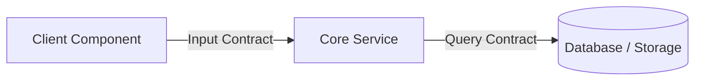
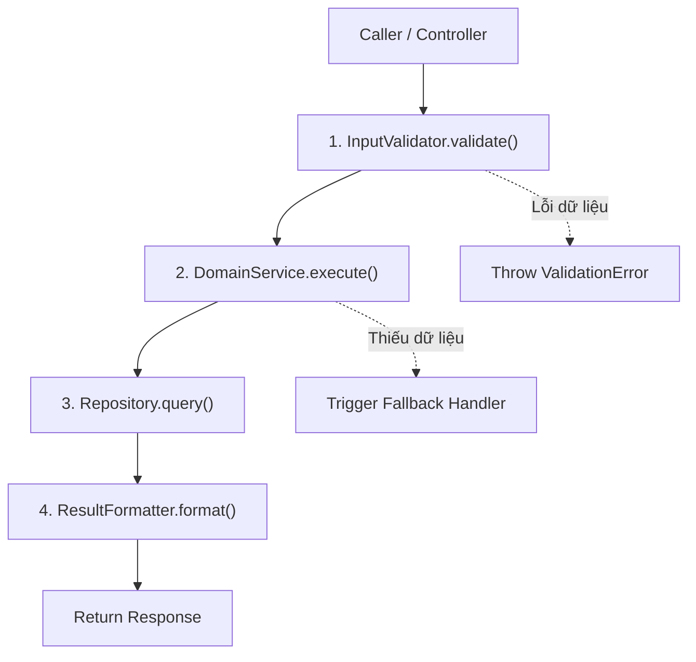

# Bước 2 & Bước 3: Kế hoạch Kỹ thuật — [Tên tính năng]

---

# PHẦN A: BƯỚC 2 — KIẾN TRÚC (SYSTEM ARCHITECTURE)

## 1. Hợp đồng giữa các Component (Component Contracts)
* **Thành phần A <-> Thành phần B:**
  - Giao thức (REST API / Function Call / Event Bus / SSE Streaming).
  - Input Payload hợp lệ.
  - Output Contract cam kết.



## 2. Mô hình Dữ liệu (Data Models & Schemas)
* Cấu trúc bảng Database hoặc DTOs nghiệp vụ:
```sql
-- DDL Schema nếu có
```

## 3. Ràng buộc & Ranh giới Bất biến (Invariants & Fallback Boundaries)
* **Ràng buộc an toàn (Invariants):** Điều kiện luôn phải đúng (Ví dụ: Score nằm trong [0.0, 1.0], không bao giờ nạp data rác vào DB).
* **Ranh giới sự cố (Fallback Boundaries):** Khi component phụ thuộc chết hoặc dữ liệu thiếu thì hệ thống phản ứng như thế nào để đảm bảo tính an toàn.

---

# PHẦN B: BƯỚC 3 — PROGRAM DESIGN (THIẾT KẾ CHI TIẾT MÃ NGUỒN)

## 1. Kiểu dữ liệu & Interfaces (Types)
```typescript
// Định nghĩa kiểu dữ liệu chi tiết cho module
export interface FeatureInput {
  // ...
}

export interface FeatureOutput {
  // ...
}
```

## 2. Danh mục Hàm & Chữ ký (Signatures)
* `function processRequest(input: FeatureInput): Promise<FeatureOutput>`
  - **Tham số:** `input` (dữ liệu đã validate tại trust boundary)
  - **Trả về:** `FeatureOutput` (kết quả chuẩn hóa)
  - **Ngoại lệ:** Ném lỗi có cấu trúc (`ValidationError`, `NotFoundError`)

## 3. Sơ đồ Luồng Gọi Hàm (Call Graph)


